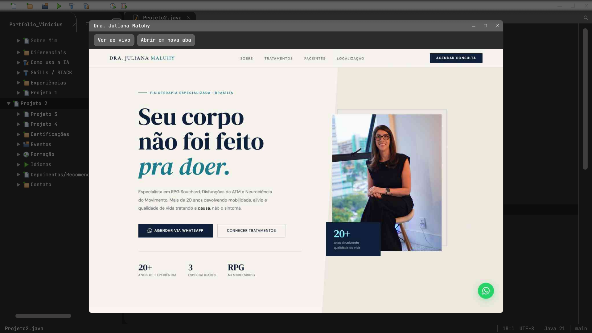
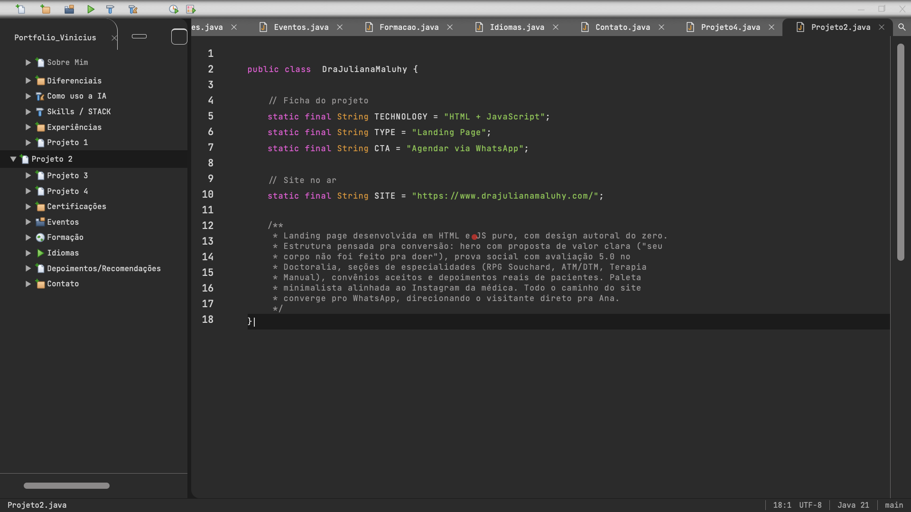

# 0007: Projetos e janela de preview

- **Data:** 2026-10-13
- **Change:** [projetos-e-janela-de-preview](../../openspec/changes/projetos-e-janela-de-preview/)
- **PR:** a definir
- **ADRs:** nenhum novo. A change segue o [ADR-0010](../adr/0010-design-como-referencia-e-java-moderno.md).

## Problema

As quatro seções de projetos ainda mostravam o aviso de "em construção", e são elas que mostram
trabalho real entregue. Dois dos projetos são sites no ar, e o design mostra uma janela de preview
abrindo sobre a IDE. Faltava decidir como mostrar um site de terceiros dentro do portfólio sem
deixá-lo pesado nem carregar nada que o visitante não pediu.

## Decisões

- **Captura primeiro, "Ver ao vivo" sob demanda.** Eu escolhi entre três opções: só o site ao
  vivo, só capturas, ou captura com o ao vivo opcional. Fiquei com a terceira: a janela abre com
  uma captura rolável e o site real só carrega num `iframe` quando o visitante clica em "Ver ao
  vivo", para não carregar site de terceiros sem ele pedir. O `iframe` usa `sandbox` e não envia
  referrer. Há também "Abrir em nova aba".
- **O "▶ Executar" da IDE abre a janela.** Como rodar o projeto numa IDE de verdade. O play da barra
  de ferramentas e um botão "Executar" abaixo do código só ficam ativos nas rotas com preview.
- **Os dois sites aceitam `iframe`.** Conferi nos cabeçalhos (sem `X-Frame-Options` nem CSP
  restritiva) antes de construir o ao vivo.
- **Registro de previews e script de captura.** Um mapa `slug -> preview` em `core/previews.ts`
  e um script versionado, `scripts/capturar-previews.mjs`, que regera as capturas quando um site
  mudar. Acrescentar um projeto novo é uma entrada no registro.
- **Projeto 4 em três páginas**, uma para cada case da Memora. Projetos 1 a 3 entram em Java
  legível, como nas seções anteriores.

## Aprendizado

- **A captura da Dra. Juliana saiu sem a foto da doutora, duas vezes.** O site anima a entrada
  da foto e a captura de página inteira não esperava a animação. A solução foi emular movimento
  reduzido no script e neutralizar a animação daquela coluna.
- **O agente de UI travou duas vezes numa pergunta de permissão**, por salvar imagens fora do
  projeto. A regra ficou: tudo dentro de `.maestri/capturas/`.
- **A digitação do editor não terminava em abas em segundo plano.** O `requestAnimationFrame` é
  pausado em aba oculta, e o código ficava pela metade. Ganhou um fallback por tempo, e o mesmo
  cuidado entrou no fechamento da janela (um teto de 300 ms se `animationend` não vier).
- **Acessibilidade e movimento valem para a janela também.** `<dialog>` modal dá foco preso e
  Escape de graça, o foco volta a quem abriu, e com movimento reduzido não há animação.
- **Números finais.** 616 testes unitários e 410 testes E2E.

## Links

- Change: [`openspec/changes/projetos-e-janela-de-preview`](../../openspec/changes/projetos-e-janela-de-preview/)
- Documentação: [componentes](../componentes.md)
- Entrada anterior: [0006 certificações, níveis e legibilidade](0006-certificacoes-niveis-e-legibilidade.md)

## Rascunho de post para o LinkedIn

> Como mostrar um site de cliente dentro do seu portfólio sem carregar nada que o visitante não
> pediu?
>
> Na seção de projetos do meu portfólio, que simula uma IDE, eu precisava de uma janela de preview
> dos sites que entreguei. Pensei em três caminhos: só o site ao vivo, só capturas, ou os dois.
> Escolhi captura primeiro e "Ver ao vivo" sob demanda: o site de terceiros só carrega num iframe
> com sandbox quando a pessoa clica. E o botão "Executar" da IDE abre a janela, como rodar o
> projeto.
>
> No caminho, uma captura saiu sem a foto da doutora duas vezes, porque o site anima a entrada da
> imagem. Resolvi emulando movimento reduzido no script. Também descobri que a digitação do editor
> não terminava em abas em segundo plano, porque o requestAnimationFrame pausa; entrou um fallback
> por tempo.
>
> A change fechou com 616 testes unitários e 410 testes E2E.
>
> Você prefere ver o site ao vivo ou uma captura num portfólio?
>
> #Angular #Java #IA
