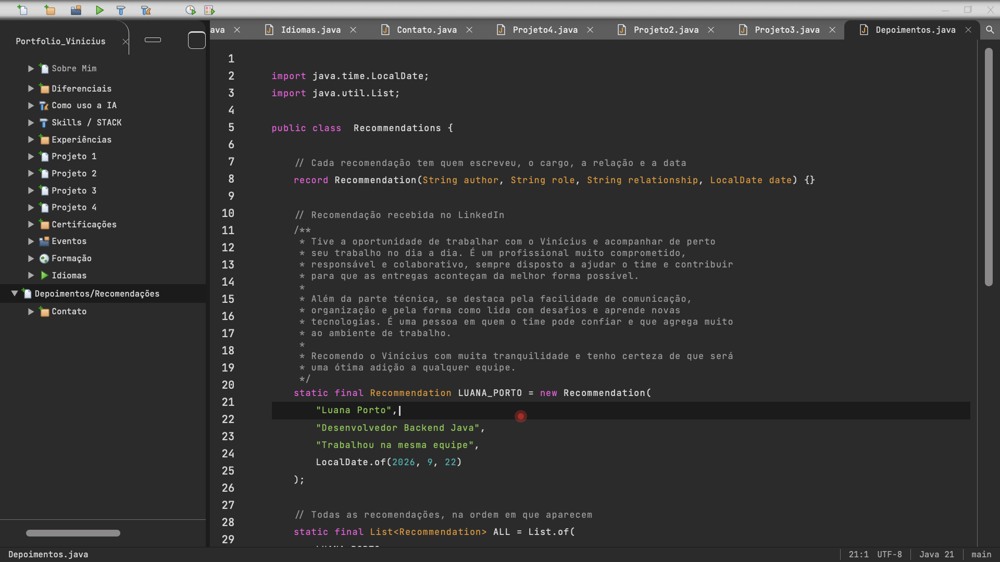

# 0008: Seção Depoimentos/Recomendações

- **Data:** 2026-10-13
- **Change:** [secao-depoimentos](../../openspec/changes/archive/2026-10-13-secao-depoimentos/)
- **PR:** [#23](https://github.com/viniassuncao1/Portifolio-Vinicius-Machado/pull/23)
- **ADRs:** nenhum novo. A change segue o [ADR-0010](../adr/0010-design-como-referencia-e-java-moderno.md).

## Problema

Depoimentos/Recomendações era a última seção ainda com o aviso de "em construção". No design, a
tela 29 só tinha Lorem Ipsum, e eu preferi esperar por conteúdo real a publicar texto de
enchimento. Agora chegou: a primeira recomendação que recebi no LinkedIn.

## Decisões

- **Conteúdo real, no texto exato.** Entrou a recomendação de Luana Porto (Desenvolvedora Backend
  Java), que trabalhou na mesma equipe que eu, de 22/09/2026. Ela é pública no meu perfil e foi
  escrita para mim, então uso só o que está nela.
- **Pronta para as próximas.** A seção usa um `record Recommendation` e uma lista `ALL`. Uma
  recomendação nova é uma entrada a mais na lista, e as páginas da seção crescem se precisar.
- **O Javadoc passou a aceitar parágrafos.** A recomendação tem três parágrafos, e o editor os
  desenhava como três blocos Javadoc seguidos. Agora o texto é um único bloco, como em Java
  idiomático.
- **Sem busca automática.** Descartei buscar recomendações no LinkedIn: a lista é editada à mão.

## Aprendizado

- **Esperar por conteúdo real valeu a pena.** Uma seção de depoimentos com Lorem Ipsum seria
  pior do que o aviso de "em construção".
- **Um caso real pediu um ajuste no editor.** O texto de uma pessoa de verdade expôs a limitação
  do Javadoc de um parágrafo só, algo que o conteúdo fictício não mostrou.
- **As 15 seções da árvore estão completas.**
- **Números finais.** 630 testes unitários (98,2% das linhas), 422 testes E2E e 24 rotas pré-renderizadas, com o axe sem violações.

## Fechamento: a trajetória do projeto

O portfólio nasceu na [fundação](0001-fundacao-do-projeto.md), com Angular 22, CI/CD e a equipe
de IA. A [casca da IDE](0002-fundacao-visual-e-casca-da-ide.md) trouxe os tokens e o editor de
código; as [primeiras seções](0003-secoes-sobre-mim-e-diferenciais.md) e as de
[IA e Skills](0004-secoes-como-uso-ia-e-skills.md) o encheram de conteúdo. A
[experiência de IDE com Java moderno](0005-experiencia-de-ide-e-java-moderno.md) fez o site se
comportar como uma IDE, e a [legibilidade](0006-certificacoes-niveis-e-legibilidade.md) o
deixou claro para quem recruta. Os
[projetos com preview](0007-projetos-e-janela-de-preview.md) mostraram o trabalho entregue, e
esta entrada fecha o conteúdo.

## Links

- Change: [`openspec/changes/archive/2026-10-13-secao-depoimentos`](../../openspec/changes/archive/2026-10-13-secao-depoimentos/)
- Documentação: [componentes](../componentes.md)
- Entrada anterior: [0007 projetos e janela de preview](0007-projetos-e-janela-de-preview.md)

## Rascunho de post para o LinkedIn

> Meu portfólio está completo: as 15 seções da árvore têm conteúdo.
>
> A última a ficar pronta foi a de recomendações. No design, ela só tinha Lorem Ipsum, e eu
> preferi esperar a ter algo real. Chegou a primeira recomendação que recebi no LinkedIn, da
> Luana Porto, que trabalhou comigo na mesma equipe. Ela agora aparece como um arquivo Java,
> como o resto do site, e acrescentar a próxima é uma entrada a mais numa lista.
>
> O texto dela tem três parágrafos, e o meu editor os desenhava como três blocos de Javadoc
> seguidos. Corrigi para um bloco só, como em Java de verdade. Foi um caso real que mostrou o
> que o conteúdo fictício não mostrava.
>
> O caminho até aqui: fundação com Angular e CI/CD, a casca de IDE, as seções, o comportamento de
> IDE com Java moderno, a legibilidade para quem recruta e os projetos com janela de preview.
> Tudo documentado em oito entradas deste diário.
>
> Qual foi a última vez que você esperou por conteúdo real em vez de usar um texto de enchimento?
>
> #Angular #Java #IA
