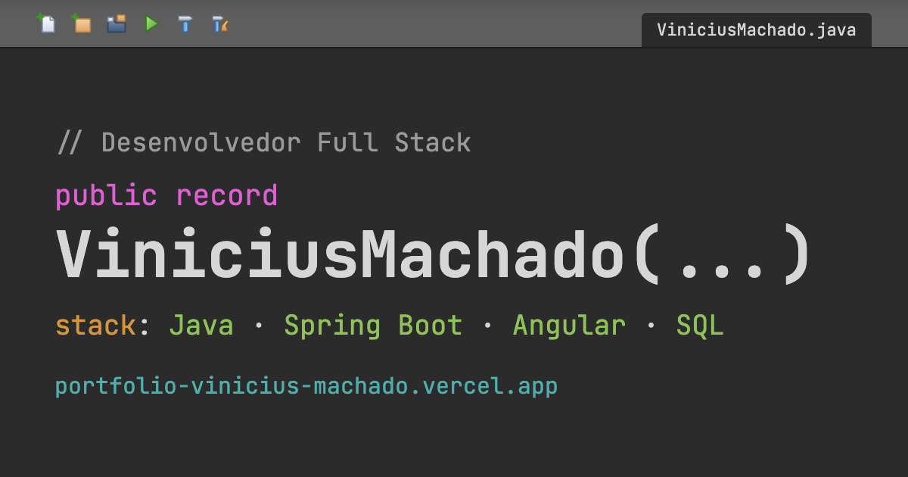

# 0009: SEO e compartilhamento

- **Data:** 2026-10-13
- **Change:** [seo-e-compartilhamento](../../openspec/changes/seo-e-compartilhamento/)
- **PR:** a definir
- **ADRs:** nenhum novo.

## Problema

O portfólio vai ser divulgado no LinkedIn, e o link aparecia **sem imagem nem resumo**: o site só
tinha um título e uma descrição genérica. Os buscadores também não recebiam sitemap, endereço
canônico nem dados estruturados.

## Decisões

- **Cartão de compartilhamento.** Open Graph e Twitter/X com título, descrição, imagem 1200x630 e
  endereço de cada página, para o link aparecer com imagem e resumo no LinkedIn, WhatsApp e X.
- **Um serviço só, `Seo`** (`core/seo.ts`). A cada `NavigationEnd` ele escreve os metadados com
  `Meta` e `DOCUMENT`, sem `window`. O domínio público fica numa constante, `URL_DO_SITE`, a única
  coisa a trocar quando houver domínio próprio.
- **Descrição própria por seção**, em pt-BR e com até 160 caracteres, no campo `descricao` de
  cada `Secao`.
- **JSON-LD `Person`** (nome, cargo, LinkedIn, GitHub e stack) só no Início.
- **Imagem gerada por script** (`scripts/gerar-imagem-de-compartilhamento.mjs`) e versionada, para
  ser refeita quando o visual mudar.
- **Sitemap gerado no build** (`scripts/gerar-sitemap.mjs`), a partir das páginas
  pré-renderizadas, e um `robots.txt` estático que aponta para ele. Assim o sitemap acompanha as
  rotas sem manutenção.
- **Tudo pré-renderizado.** O LinkedIn e os buscadores não executam JavaScript, então os
  metadados precisam estar no HTML entregue. Isso é a razão de usar `Meta` e `DOCUMENT` durante o
  render. Descartei imagens diferentes por seção, domínio próprio e analytics, que ficam para
  outra change.

## Aprendizado

- **O `og:title` saía com o título da rota anterior.** No `NavigationEnd`, o `Title` ainda não
  tinha sido atualizado, então o serviço lia o título velho. Foi preciso extrair o cálculo do
  título (`tituloDaJanela`), que passou a ser usado tanto para gravar o título da janela quanto
  pelo `Seo`.
- **A primeira imagem não funcionou em miniatura.** Era uma captura da IDE, e o nome ficava
  ilegível no tamanho em que o LinkedIn mostra o cartão. Virou um cartão no visual da IDE, com o
  nome em destaque.
- **A prévia do LinkedIn fica em cache.** Depois de um deploy, é preciso pedir a atualização no
  Post Inspector. O passo a passo está no README.
- **Números finais.** 635 testes unitários (98,4% das linhas), 461 testes E2E e 24 rotas pré-renderizadas, com o axe sem violações.

## Links

- Change: [`openspec/changes/seo-e-compartilhamento`](../../openspec/changes/seo-e-compartilhamento/)
- Documentação: [arquitetura](../arquitetura.md#seo-e-compartilhamento) e o
  [README](../../README.md#compartilhamento-no-linkedin)
- Entrada anterior: [0008 seção de depoimentos](0008-secao-depoimentos.md)

## Rascunho de post para o LinkedIn

> Eu ia divulgar meu portfólio no LinkedIn e percebi que o link aparecia pelado: sem imagem e sem
> resumo.
>
> Resolvi com metadados de compartilhamento (Open Graph e Twitter/X), uma descrição própria para
> cada seção, dados estruturados, sitemap gerado no build e um robots.txt. Um serviço de SEO
> escreve tudo a cada navegação, e como o LinkedIn não executa JavaScript, tudo vai no HTML
> pré-renderizado.
>
> Dois tropeços: o título do cartão saía com o da página anterior, porque o título da janela ainda
> não tinha sido atualizado quando o serviço rodava. Tive que extrair o cálculo do título para
> usar nos dois lugares. E a primeira imagem era uma captura da IDE em que meu nome ficava
> ilegível em miniatura. Troquei por um cartão no visual da IDE, com o nome em destaque.
>
> Um detalhe que quase passa batido: o LinkedIn guarda a prévia em cache, e é preciso pedir a
> atualização no Post Inspector depois de cada deploy.
>
> Você já testou como o seu link aparece quando é compartilhado?
>
> #Angular #SEO #LinkedIn
