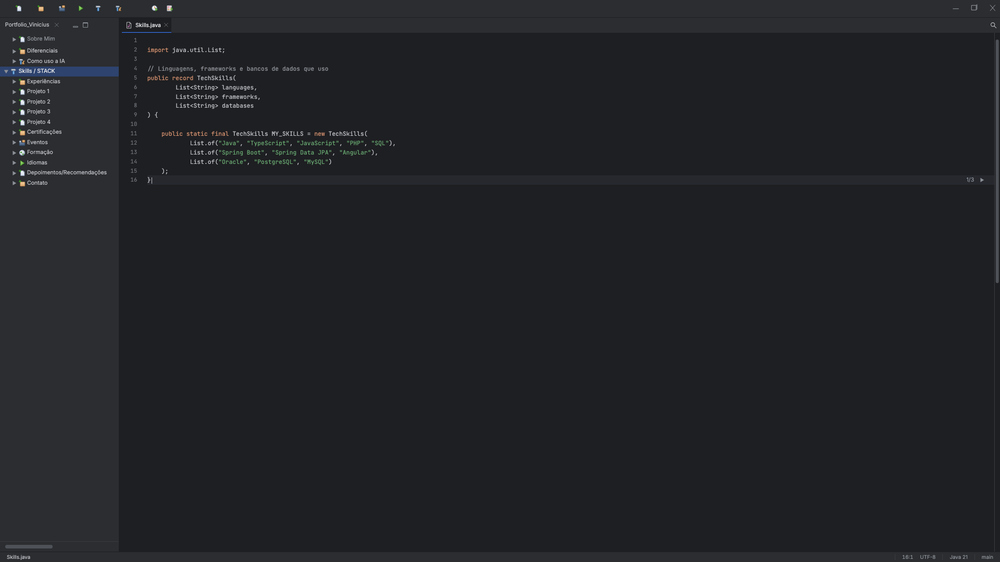
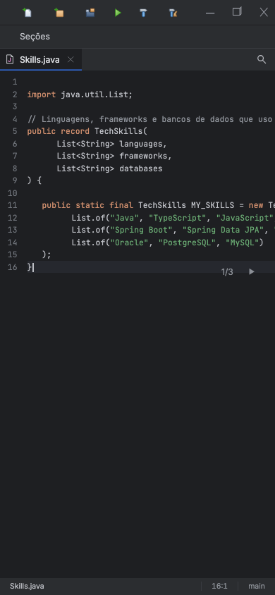

# 0010: Tokens e tipografia do IntelliJ New UI

- **Data:** 2026-10-13
- **Change:** [tokens-e-tipografia-intellij](../../openspec/changes/tokens-e-tipografia-intellij/)
- **PR:** a definir
- **ADRs:** [0011](../adr/0011-identidade-visual-intellij-new-ui.md)

## Problema

Com o site completo e no ar, eu o revisei com as skills `design-taste-frontend` e
`web-design-guidelines` e escrevi um briefing de redesign. A conclusão: o site parecia uma IDE
antiga e grande demais. A árvore tinha texto de 16px e linhas de 33px, o painel lateral media
395px, as abas tinham 294px fixos, o editor tinha raio de 18px e o acento era um rosa. O público
das vagas de Java e Spring usa o **IntelliJ IDEA**, cuja New UI é escura, compacta e de cor sólida.

## Decisões

- **A identidade passa a ser a do IntelliJ New UI.** Está no
  [ADR-0011](../adr/0011-identidade-visual-intellij-new-ui.md), que também escolheu pacotes por
  funcionalidade para a árvore (e não por camada) e identificadores de domínio em português no
  Java exibido. As telas do design deixam de ser a referência visual e ficam só como fonte das
  informações.
- **O redesign foi fatiado em 6 changes.** Esta é a primeira: a de maior ganho visual com menor
  risco, feita quase só por tokens.
- **Paleta Dark com um único acento.** Editor `#1E1F22`, painéis `#2B2D30`, seleção `#2E436E`,
  texto `#BCBEC4` e as cores de sintaxe do IntelliJ. O rosa saiu e ficou um só acento, o azul
  `#3574F0`, também no anel de foco de 2px.
- **Duas fontes.** Inter 13px na interface e JetBrains Mono 14px no código, as duas servidas pelo
  próprio site.
- **Ajustes nativos.** `color-scheme: dark`, `theme-color`, números tabulares e `translate="no"`
  no código.

## Antes e depois

Medidas de produção, antes e depois:

| Elemento       | Antes       | Depois      |
| -------------- | ----------- | ----------- |
| Árvore         | 16px / 33px | 13px / 24px |
| Código         | 15px / 29px | 14px / 22px |
| Painel lateral | 395px       | 280px       |
| Aba            | 294px fixos | nome + 32px |
| Raio do editor | 18px        | 0           |

## Aprendizado

- **Concentrar tudo em `_tokens.scss` pagou a conta.** Foi uma decisão antiga, tomada nas
  primeiras changes. Por causa dela, trocar a identidade inteira foi, quase só, trocar valores,
  com ajustes pontuais onde havia medida fixa (a aba passou de largura fixa para a do conteúdo).
- **A cor original do IntelliJ reprovava no contraste.** O comentário do tema (`#7A7E85`) dava
  4,04:1, abaixo do mínimo AA de 4,5:1. Clareei para `#8C9097` (5,14:1). Copiar uma IDE de verdade
  não garante acessibilidade.
- **Fatiar deixa cada passo entregável.** Cada change vai ao ar completa e coerente, mesmo que o
  site fique "meio IntelliJ" até a última. Aceitei isso em troca de risco menor.
- **Números finais.** Testes unitários: a definir. Testes E2E: a definir.

## Links

- Change: [`openspec/changes/tokens-e-tipografia-intellij`](../../openspec/changes/tokens-e-tipografia-intellij/)
- ADR: [0011 identidade visual do IntelliJ New UI](../adr/0011-identidade-visual-intellij-new-ui.md)
- Documentação: [componentes](../componentes.md) e [arquitetura](../arquitetura.md)
- Entrada anterior: [0009 SEO e compartilhamento](0009-seo-e-compartilhamento.md)

## Rascunho de post para o LinkedIn

> Revisei o meu próprio portfólio no ar e a conclusão foi dura: parecia uma IDE antiga e grande
> demais.
>
> A árvore tinha texto de 16px e linhas de 33px, o painel lateral media 395px, as abas tinham
> 294px fixos e o editor tinha cantos de 18px. Como as vagas que busco são de Java e Spring, e
> quem trabalha com isso usa o IntelliJ, decidi trocar a identidade visual pela do IntelliJ New
> UI e registrei a decisão num ADR.
>
> A primeira de seis changes foi quase só trocar tokens de design: árvore de 16px para 13px,
> código de 15px para 14px, painel de 395px para 280px, raio de 18px para zero, um único acento
> azul no lugar do rosa. Foi rápido porque desde o começo todos os valores moram num arquivo só.
>
> Um detalhe: a cor de comentário original do IntelliJ reprovava no contraste de acessibilidade,
> com 4,04 para um mínimo de 4,5. Clareei até 5,14. Copiar a referência não dispensa medir.
>
> Você mediu o contraste das cores que copiou de alguma referência?
>
> #Angular #Acessibilidade #IntelliJ
