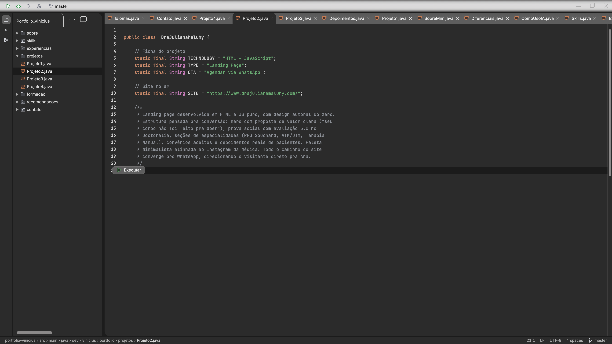
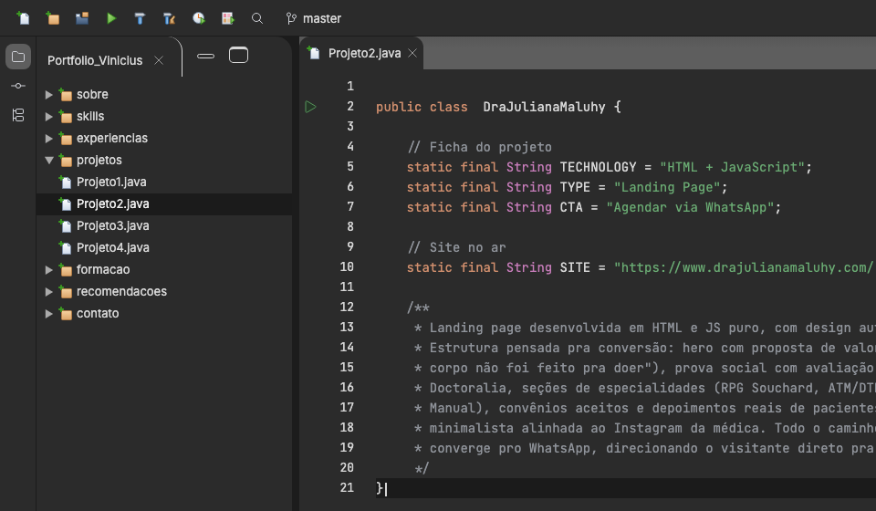
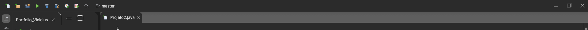
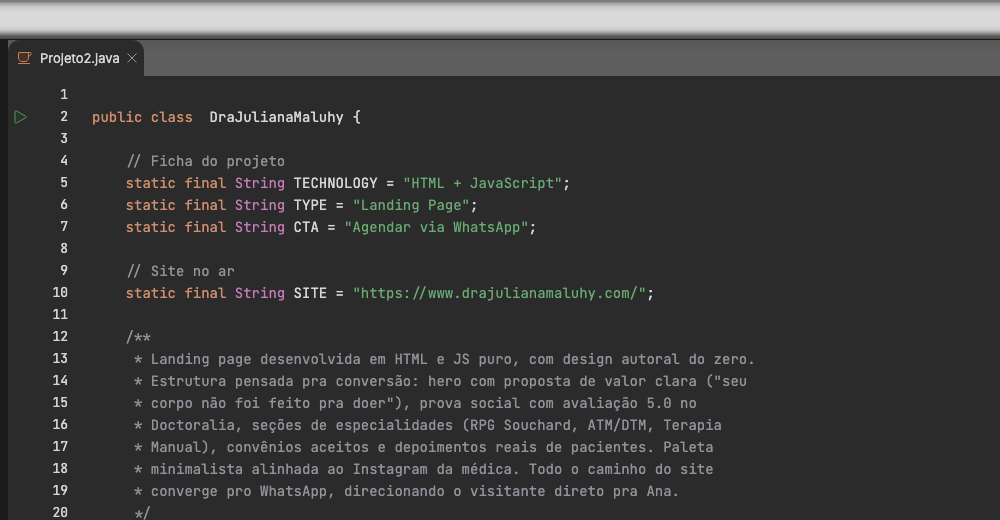

# 0011: Design original com ícones e Git

- **Data:** 2026-10-14
- **Change:** [design-original-com-icones-e-git](../../openspec/changes/archive/2026-10-14-design-original-com-icones-e-git/) (começou como "barras e ícones da New UI")
- **PR:** [#27](https://github.com/viniassuncao1/Portifolio-Vinicius-Machado/pull/27)
- **ADRs:** [0012](../adr/0012-design-original-com-elementos-do-intellij.md), que substitui em parte o [0011](../adr/0011-identidade-visual-intellij-new-ui.md)

## Problema

Depois da [change de tokens](0010-tokens-e-tipografia-intellij.md), a segunda etapa do
[ADR-0011](../adr/0011-identidade-visual-intellij-new-ui.md) refez a moldura do site no IntelliJ
New UI: barra superior, faixa de ferramentas, painel do projeto, barra de status e ícones
oficiais. Quando o Vinicius viu o resultado, a conclusão foi que o site ficou **"literalmente o
IntelliJ"**. Tecnicamente estava certo, e era justamente o problema: o portfólio perdeu a
identidade do design feito sob encomenda para ele, que é o que o diferencia de qualquer outro
site com cara de IDE.

## Decisões

A mudança de rumo não foi um passo só. Foram **vários ciclos de feedback**, cada um olhando o site
no ar e ajustando:

1. **O design original volta e predomina.** O
   [ADR-0012](../adr/0012-design-original-com-elementos-do-intellij.md) devolve a paleta dos
   cinzas do design (fundos `#2B2B2B` e `#1C1C1C`), o foco rosa `#DE60D2`, os controles de janela,
   o editor arredondado, as abas e o cabeçalho `Portfolio_Vinicius`. Do IntelliJ ficam os
   elementos de IDE de verdade: estrutura em pastas, referências ao Git, a faixa de ferramentas,
   a barra de status com o caminho do arquivo e a tipografia compacta (Inter e JetBrains Mono).
2. **A árvore virou pastas.** As seções são arquivos `.java` dentro de pacotes (`sobre`,
   `skills`, `experiencias`, `projetos`, `formacao`, `recomendacoes`, `contato`), com todos os
   links presentes no HTML pré-renderizado.
3. **As cores de sintaxe são as do Java no IntelliJ.** O comentário saiu de `#7A7E85` para
   `#8F939A`, porque o original reprovava no contraste AA.
4. **O ▶ Executar foi para a calha.** Em vez do botão sobre o código, o ▶ fica à esquerda dos
   números, na linha `public class`, como no IntelliJ de verdade.
5. **Os ícones voltaram a ser os do design.** Depois de ver a versão com ícones da IntelliJ
   Platform em tudo, o Vinicius pediu os do design na árvore, nas abas e na barra. Os do IntelliJ
   ficaram só no ▶, na branch, na busca e na faixa de ferramentas, e a variante clara dos ícones
   saiu.
6. **A barra de ferramentas ficou escura, sem o degradê.** Com o degradê claro do design, a barra
   branca destoava do resto da interface escura. É um **desvio assumido do design**, pedido pelo
   Vinicius e registrado no ADR-0012.

- **A mudança de ideia virou um ADR.** Em vez de reverter em silêncio, o ADR-0012 registra o que
  eu pensei, o que vi e por que mudei, e mantém o ADR-0011 no histórico como "substituído em
  parte". Descartei manter o IntelliJ puro (fiel à IDE, mas apaga o design) e voltar ao design
  sem nada do IntelliJ (recupera a identidade, mas perde os elementos de IDE e a escala compacta
  que resolveram o "tudo grande demais").

## Aprendizado

- **Testar uma direção custa menos do que discuti-la.** Só vendo o IntelliJ no ar ficou claro que
  ele era demais. Fatiar o redesign em changes pequenas permitiu parar na segunda, antes de
  investir nas outras no visual errado.
- **O resultado final não saiu de um plano, saiu de ciclos curtos de feedback.** Cada olhada no
  site no ar rendeu um ajuste: pastas, ícones, a barra escura. Nenhum estava no briefing inicial.
- **Dá para voltar mantendo o que funcionou.** A virada não jogou fora o trabalho: a escala
  compacta, os pacotes, o Git e os breadcrumbs ficaram. Separar "identidade" de "elementos de IDE"
  tornou possível ficar com uma parte e trocar a outra, e os valores visuais concentrados em
  `_tokens.scss` fizeram a volta ser, em grande parte, troca de valores.
- **ADR também serve para mudar de ideia, e para registrar o desvio.** A barra escura foge do
  design original, e o motivo está escrito.
- **Os testes acharam o bug que o ▶ criou.** Ao mover o Executar para a calha, o controle de
  páginas ficou coberto pelo editor posicionado. Quem achou foram os testes, e a correção manteve
  o controle acima da calha.
- **Ícones têm licença.** Os da IntelliJ Platform são Apache 2.0, então os créditos ficam em
  `public/icones/new-ui/CREDITOS.md`, com uma seção no README, e nenhum logotipo do IntelliJ ou
  da JetBrains entrou. Ao reduzir o uso deles, a pasta também encolheu.
- **No `pull_request`, o `GITHUB_SHA` é o commit de merge.** Esse commit temporário não existe na
  branch e o link do commit na barra de status quebrava no deploy de preview. O script do build lê
  primeiro `SHA_DO_COMMIT`, que o workflow define com `github.event.pull_request.head.sha`.
- **O índice do Git compartilhado misturou arquivos num commit.** Com vários agentes na mesma
  cópia do repositório, um commit levou arquivos de outra faixa. É a lição das entradas
  [0005](0005-experiencia-de-ide-e-java-moderno.md) e
  [0006](0006-certificacoes-niveis-e-legibilidade.md): `git add` só com o caminho exato.
- **Números finais.** 663 testes unitários (96,79% de cobertura) e 531 testes E2E.

## Links

- Change: [`openspec/changes/archive/2026-10-14-design-original-com-icones-e-git`](../../openspec/changes/archive/2026-10-14-design-original-com-icones-e-git/)
- ADRs: [0012 design original com elementos do IntelliJ](../adr/0012-design-original-com-elementos-do-intellij.md)
  e [0011 identidade visual do IntelliJ New UI](../adr/0011-identidade-visual-intellij-new-ui.md)
- Documentação: [componentes](../componentes.md), [arquitetura](../arquitetura.md) e os
  [créditos dos ícones](../../public/icones/new-ui/CREDITOS.md)
- Entrada anterior: [0010 tokens e tipografia](0010-tokens-e-tipografia-intellij.md)

## Rascunho de post para o LinkedIn

> Testei uma direção de design, vi o resultado e voltei atrás. Depois voltei mais três vezes.
>
> Meu portfólio simula uma IDE, e eu refiz a moldura no estilo do IntelliJ, a IDE mais usada em
> Java. Ficou fiel demais: quando vi no ar, estava literalmente o IntelliJ, e o design feito sob
> encomenda para mim, que é o que diferencia o site, tinha sumido.
>
> Em vez de insistir, registrei a mudança de ideia num ADR e fui ajustando em ciclos curtos, sempre
> olhando o site no ar. O design original voltou a predominar. Do IntelliJ ficaram a árvore em
> pastas, as cores do Java, o botão de executar na calha do editor, a branch e o commit na barra
> de status. Os ícones voltaram a ser os do design. E a barra de ferramentas ficou escura, um
> desvio assumido do design porque a faixa clara destoava do resto, com o motivo escrito no ADR.
>
> Fechou com 663 testes unitários, 96,79% de cobertura e 531 testes E2E.
>
> O que eu levo: fatiar o redesign me deixou parar cedo no visual errado, e o resultado bom não veio
> de um plano, veio de olhar, ajustar e olhar de novo.
>
> Você planeja o design inteiro antes ou ajusta olhando o resultado?
>
> #Angular #Design #ADR
