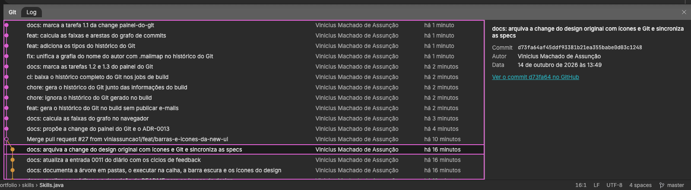
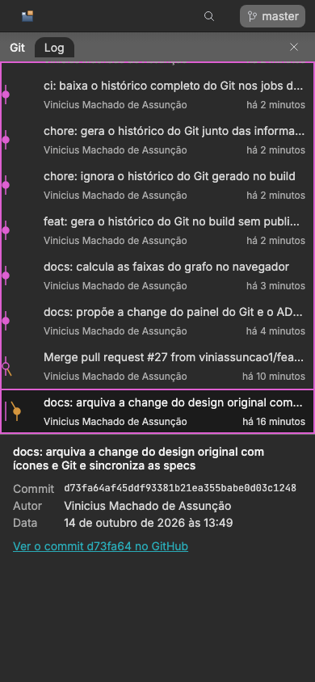

# 0012: Painel do Git

- **Data:** 2026-10-14
- **Change:** [painel-do-git](../../openspec/changes/archive/2026-10-14-painel-do-git/)
- **PR:** [#28](https://github.com/viniassuncao1/Portifolio-Vinicius-Machado/pull/28)
- **ADRs:** [0013](../adr/0013-historico-do-git-gerado-no-build.md)

## Problema

A barra de ferramentas mostrava `master` e a faixa de ferramentas tinha o ícone Commit, mas os dois
eram só decoração. A ideia do Vinicius foi fazê-los abrir um **painel do Git com o histórico real
do próprio repositório**, como o Git Log do IntelliJ: o portfólio mostrando como foi feito.
Além de completar a experiência de IDE, o painel expõe o processo a quem visita: Conventional
Commits em pt-BR, PRs, merges e deploys contínuos.

## Decisões

- **O histórico é gerado no build.** Um script lê o `git log` e grava um JSON estático servido pelo
  próprio site ([ADR-0013](../adr/0013-historico-do-git-gerado-no-build.md)). Descartei a API do
  GitHub no navegador (limite de 60 requisições por hora sem token, rede e lentidão) e a API no
  build (exigiria token no CI, sem ganho sobre o `git log`, que já está no runner).
- **Sem e-mails.** O JSON guarda SHA, pais, nome do autor, data, assunto e, nos merges, o número do
  PR e a branch. Nada de e-mail.
- **O `.mailmap` unifica o nome.** O autor aparecia com grafias diferentes; o `.mailmap` da raiz e
  o formato `%aN` mostram uma só.
- **O CI baixa o histórico completo.** Os jobs de build usam `fetch-depth: 0`; num clone raso o
  histórico sairia vazio. Nesse caso, ou sem `git`, o script grava a lista vazia e o painel avisa,
  sem quebrar o build.
- **As faixas do grafo são calculadas no navegador.** `calcularFaixas` é uma função pura em
  `core/git/`, o que permite testá-la com o Vitest e deixa o script simples.
- **Carregamento sob demanda.** O JSON só é baixado quando o painel abre pela primeira vez; o
  carregamento inicial do site não muda.
- **Abre pela branch e pelo Commit.** O `master` da barra e o ícone Commit da faixa viram botões
  reais; Esc fecha e devolve o foco. No celular, o painel ocupa a tela.

## Aprendizado

- **O portfólio pode mostrar o próprio processo.** O histórico de Conventional Commits em pt-BR, as
  changes e os PRs são parte do que o projeto prova, e agora estão visíveis no site.
- **Dá para ter o histórico sem token e sem expor dados.** Ler o `git log` no build evita o limite
  da API do GitHub, e não publicar e-mails resolve a privacidade.
- **Colocar a conta do grafo no navegador facilitou os testes.** Uma função pura que recebe commits
  e devolve faixas e arestas é testável sem montar o painel.
- **O `GITHUB_SHA` de merge já estava tratado.** O problema do commit de merge no
  `pull_request`, achado na [entrada 0011](0011-design-original-com-icones-e-git.md), tinha
  deixado `SHA_DO_COMMIT` pronto; o painel aproveitou a mesma ideia de ler o ambiente do CI.
- **Números finais.** Testes unitários: 713 (cobertura de 96,59%). Testes E2E: 565, com 34 do painel do Git e axe sem exclusões.

## Links

- Change: [`openspec/changes/archive/2026-10-14-painel-do-git`](../../openspec/changes/archive/2026-10-14-painel-do-git/)
- ADR: [0013 histórico do Git gerado no build](../adr/0013-historico-do-git-gerado-no-build.md)
- Documentação: [arquitetura](../arquitetura.md#painel-do-git) e [componentes](../componentes.md)
- Entrada anterior: [0011 design original com ícones e Git](0011-design-original-com-icones-e-git.md)

## Rascunho de post para o LinkedIn

> E se o seu portfólio mostrasse o próprio histórico de commits?
>
> Meu site simula uma IDE, e a branch "master" da barra e o ícone de commit eram só enfeite. A
> ideia foi fazê-los abrirem um painel do Git, como o Git Log do IntelliJ, com o histórico real do
> repositório: grafo das branches, commits em Conventional Commits, PRs e merges. Quem visita vê
> como o projeto foi construído.
>
> O desenho que escolhi: o histórico é gerado no build, lendo o git log, e vira um JSON estático
> que só é baixado quando o painel abre. Sem token do GitHub, sem limite de requisições e sem
> publicar e-mails. Um .mailmap unifica a grafia do meu nome, o CI baixa o histórico completo e o
> cálculo das faixas do grafo roda no navegador, o que me deixou testá-lo com testes unitários.
>
> O aprendizado: o processo também é conteúdo de portfólio. Commits pequenos e bem escritos deixam
> de ser só disciplina e viram vitrine.
>
> Você mostraria o histórico do seu projeto para um recrutador?
>
> #Angular #Git #IntelliJ
