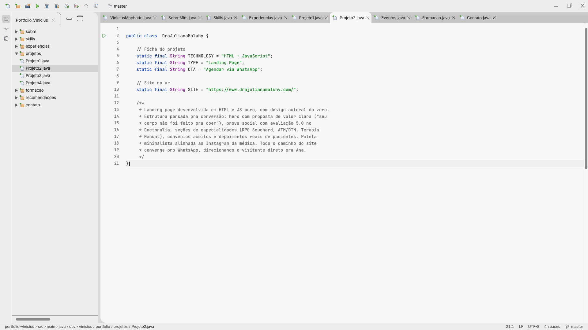
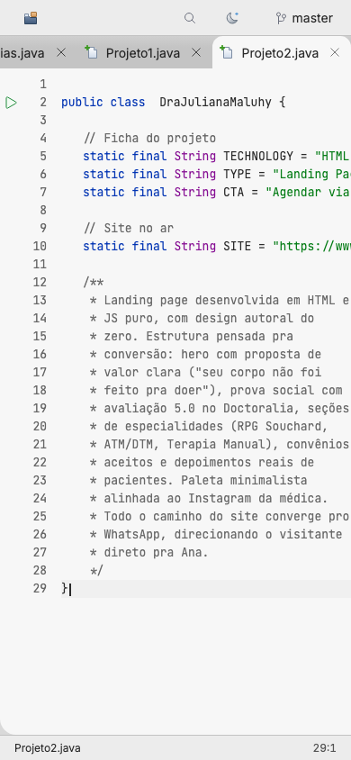

# 0013: Tema claro

- **Data:** 2026-10-14
- **Change:** [tema-claro](../../openspec/changes/tema-claro/)
- **PR:** [#29](https://github.com/viniassuncao1/Portifolio-Vinicius-Machado/pull/29)
- **ADRs:** [0014](../adr/0014-tema-claro.md)

## Problema

O design original só tem a versão escura, e o Vinicius pediu um tema claro: muita gente lê
conteúdo longo melhor em fundo claro, ou usa o sistema no claro durante o dia. Como todas as cores
já vinham de tokens, dava para oferecer os dois temas sem mexer nos componentes. O desafio estava
no resto: o site é pré-renderizado, e escolher o tema só depois que o Angular carrega faria a
página piscar.

## Decisões

- **Dois temas por tokens.** O escuro continua o padrão. O claro redefine os mesmos tokens em
  `:root[data-tema='claro']`, com a mesma hierarquia de cinzas do design, o rosa escurecido para o
  contraste e as cores de sintaxe do **IntelliJ Light**.
- **A escolha segue o sistema e vira do visitante.** Na primeira visita vale
  `prefers-color-scheme`; o botão de tema na barra de ferramentas (sol e lua) troca, e a escolha
  fica no `localStorage`.
- **Um script inline aplica o tema antes da primeira pintura.** Fica no `<head>` do `index.html`,
  só lê o `localStorage` e o `matchMedia` e é a única exceção à regra de não ter JavaScript fora do
  Angular. O serviço `Tema` assume depois, lendo o valor que o script já aplicou.
- **Sem JavaScript, vale o sistema.** Um `@media (prefers-color-scheme: light)` aplica o tema claro
  pelo CSS enquanto o `<html>` não tem `data-tema`.
- **A troca tem um crossfade curto.** Uma View Transition suaviza a mudança de tema, mas só quando o
  navegador suporta, o visitante não pediu movimento reduzido e não há uma transição de rota em
  andamento; nos outros casos, troca direta.
- **`color-scheme` e `theme-color` acompanham o tema**, e os ícones da IntelliJ Platform ganham a
  variante clara, escolhida por tokens e sem JavaScript.
- **O botão não existe no design nem no IntelliJ.** É um desvio registrado no ADR-0014, com um ícone
  simples desenhado no padrão dos demais. Descartei só `prefers-color-scheme`, sem botão (mais
  simples, mas não deixa escolher), e o tema claro do IntelliJ inteiro (destoaria do design autoral).

## Aprendizado

- **Tema sem piscar num site SSG exige um script inline.** O HTML chega pronto e o Angular só
  hidrata depois. Aplicar `data-tema` no `<html>` antes dos estilos evita o clarão de uma página
  escura (ou o contrário). O atributo fica fora da árvore do Angular, então a hidratação não
  diverge do pré-render, e o serviço lê o valor em vez de recalculá-lo.
- **As cores do IntelliJ Light reprovavam no contraste.** A anotação (`#9E880D`) e o comentário
  (`#8C8C8C`) não chegavam a 4,5:1 no fundo claro; ficaram em `#7D6B00` e `#6A6A6A`. O mesmo vale
  para o rosa do design, escurecido para o acento e o foco. Copiar uma paleta não dispensa medir.
- **Um piscar de uma fração de segundo, que ninguém veria a olho, foi pego por um teste E2E.** Num
  site que abre no tema claro, o primeiro quadro saía **escuro**. O Angular inlina só o CSS crítico
  no HTML, e o beasties leva apenas as regras que casam com o HTML pré-renderizado, que não tem
  `data-tema`; então os tokens claros ficavam de fora até o CSS completo chegar. A correção foi
  marcar o bloco dos tokens claros com comentários `/*! … */` (só os que começam com `!` sobrevivem
  ao Sass e ao esbuild, e o `removeSpecialComments: false` os mantém) e injetar um `<style>` com
  esse bloco em cada página depois do build, por um script que falha o build se os marcadores
  sumirem. Custa cerca de 2 KB por página.
- **Duas View Transitions não convivem.** A troca de tema não pode começar durante uma navegação,
  que já usa a sua, porque a segunda cancelaria a primeira; por isso ela confere se há transição ativa.
- **O Playwright passou a rodar tudo no claro.** Sem `colorScheme` definido, ele emula o tema
  claro, e depois que o script inline passou a respeitar o sistema, a suíte inteira (escrita para o
  escuro) trocou de tema sozinha. A correção foi fixar `colorScheme: 'dark'` na configuração e pedir
  o claro por teste, com `emulateMedia`.
- **Todo token novo precisa existir nos dois temas.** Contraste e axe rodam nos dois, em todas as
  seções, inclusive no painel do Git e na janela de preview.
- **Números finais.** 737 testes unitários (96,65% de cobertura) e 671 testes E2E.

## Links

- Change: [`openspec/changes/tema-claro`](../../openspec/changes/tema-claro/)
- ADR: [0014 tema claro](../adr/0014-tema-claro.md)
- Documentação: [arquitetura](../arquitetura.md#tema-claro-e-escuro) e [componentes](../componentes.md)
- Entrada anterior: [0012 painel do Git](0012-painel-do-git.md)

## Rascunho de post para o LinkedIn

> Adicionei um tema claro ao meu portfólio, e o difícil não foi o claro.
>
> Todas as cores já viviam em tokens de design, então o segundo tema virou redefinir valores. O
> problema é que o site é pré-renderizado: o HTML chega pronto, o Angular só carrega depois, e
> escolher o tema nesse momento faria a página piscar no tema errado. A solução foi um script
> inline minúsculo no head, que aplica o tema antes da primeira pintura, lendo a escolha salva ou
> o tema do sistema. Sem JavaScript, o CSS segue o sistema.
>
> O melhor achado veio de um teste E2E: o primeiro quadro do tema claro saía escuro por uma fração de segundo, que ninguém veria a olho. O CSS crítico inline não levava os tokens claros. Marquei esse bloco com comentários que sobrevivem ao build e injeto o CSS em cada página depois dele.
>
> Outras três coisas que aprendi. As cores de sintaxe do IntelliJ Light reprovavam no contraste de
> acessibilidade, então ajustei a anotação e o comentário. O Playwright, sem tema definido, emulou
> o claro e passou a rodar a suíte inteira nele, e tive que fixar o escuro por padrão. E todo token
> novo agora precisa existir nos dois temas, com axe e contraste rodando nos dois.
>
> A suíte fechou com 737 testes unitários e 671 E2E. Você testa o seu site nos dois temas, ou só no que você usa?
>
> #Angular #Acessibilidade #TemaClaro
