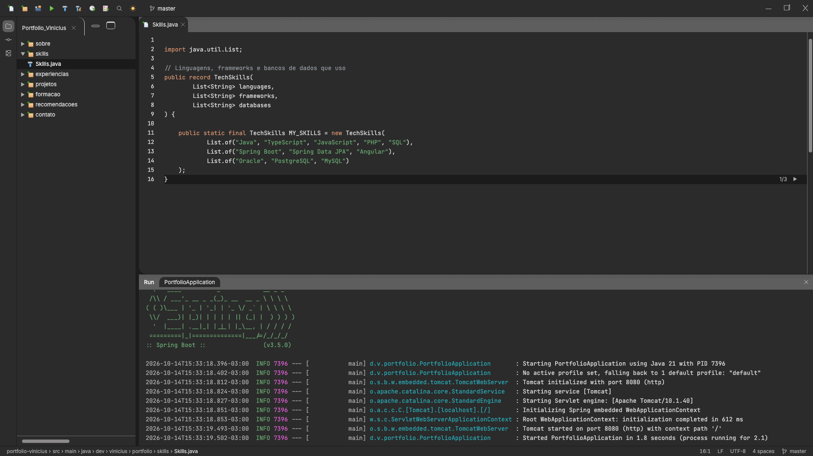
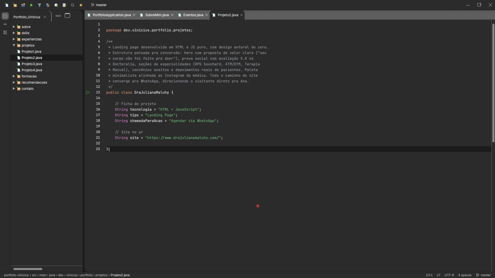

# 0014: Janela de Run e Java para leitura

- **Data:** 2026-10-14
- **Changes:** [janela-de-run](../../openspec/changes/janela-de-run/) e [java-para-leitura](../../openspec/changes/java-para-leitura/)
- **PR:** #PR_A_DEFINIR
- **ADRs:** [0011](../adr/0011-identidade-visual-intellij-new-ui.md) (itens 3 e do Run, mantidos pelo [0012](../adr/0012-design-original-com-elementos-do-intellij.md))

## Problema

Duas pontas soltas do redesign. Abrir o portfólio não parecia **rodar um projeto Spring Boot de
verdade**, e o Executar da barra só funcionava nos projetos com site. E o Java exibido ainda era
técnico demais para quem recruta: nomes em inglês (`TechSkills`, `Recommendation`), `static final`
em tudo, constantes em caixa alta (`MY_SKILLS`, `LUANA_PORTO`) e uma página inicial num arquivo
`ViniciusMachado.java` que não parecia uma aplicação.

## Decisões

- **Uma janela de Run na área de baixo.** Ela mostra o log de inicialização do
  `PortfolioApplication` (banner do Spring, `Starting PortfolioApplication using Java 21`,
  `Tomcat started on port 8080`, `Started PortfolioApplication in 1.8 seconds`). Divide a área com o
  painel do Git, **um de cada vez**, com a mesma animação.
- **Curta e nunca no caminho.** Abre sozinha **uma vez por sessão**, sem roubar o foco, revela o log
  em até 2,5 s e tem "Pular", Esc e fechar. Com movimento reduzido, não abre sozinha. O log é
  texto, a data e a hora vêm do navegador e **nada disso entra no HTML pré-renderizado**.
- **O Executar sempre tem função.** Nos projetos com site abre o preview; nos demais, reabre a
  janela de Run e reinicia o log.
- **Java com domínio em português e menos cerimônia.** `record Evento(String nome, int vezes)`,
  `List<Evento> participei = List.of(...)`, sem `static final` e sem caixa alta. Cada seção declara
  o `package` da sua pasta, e o inglês fica só nas palavras da linguagem e do Spring.
- **A página inicial virou `PortfolioApplication.java`**, com `@SpringBootApplication` e um `main`
  que apresenta o Vinicius com `var vinicius = new Desenvolvedor(...)`.
- **Uma seção de exemplo antes do resto.** `Eventos` foi reescrita primeiro e revisada, e as outras
  15 seguiram o mesmo guia, divididas entre duas especialistas.

## Aprendizado

- **Uma seção piloto evita 16 retrabalhos.** Revisar só `Eventos` antes de reescrever o resto
  fixou o estilo uma vez e manteve as duas faixas consistentes.
- **Reescrever conteúdo sem perder informação exige teste.** A spec "informações preservadas"
  continuou valendo, e os testes que conferem trechos de código mudaram no mesmo commit de cada
  seção.
- **Efeito de abertura é feito para ser ignorado.** Uma vez por sessão, "Pular" visível, movimento
  reduzido respeitado e conteúdo nunca bloqueado: o log dá sensação de rodar o projeto sem custar
  nada a quem só quer ler.
- **Duas changes, um PR.** Mesmo com faixas diferentes, as duas cabem juntas porque tocam áreas
  separadas (a casca e o conteúdo), e a mesma branch evitou conflitos.
- **Números finais.** Testes unitários: a definir. Testes E2E: a definir.

## Links

- Changes: [`janela-de-run`](../../openspec/changes/janela-de-run/) e [`java-para-leitura`](../../openspec/changes/java-para-leitura/)
- Documentação: [guia de estilo do Java](../componentes.md#guia-de-estilo), [janela de Run](../componentes.md) e [arquitetura](../arquitetura.md#área-de-baixo-git-e-run)
- Entrada anterior: [0013 tema claro](0013-tema-claro.md)

## Rascunho de post para o LinkedIn

> Abrir o meu portfólio agora "roda" um projeto Spring Boot.
>
> O site simula uma IDE, e faltavam duas coisas para convencer. A primeira é uma janela de Run
> com o log de inicialização do Spring: o banner, o Tomcat subindo na porta 8080 e o "Started
> PortfolioApplication". Aparece uma vez por sessão, dura menos de 2,5 segundos, tem botão de
> pular e respeita quem pediu menos movimento. O conteúdo nunca fica bloqueado.
>
> A segunda é o Java que o site exibe. Ainda estava técnico demais para quem recruta: nomes em
> inglês, static final em tudo, constantes em caixa alta. Reescrevi as 16 seções com domínio em
> português e menos cerimônia, para o código se ler como frase. A página inicial virou um
> PortfolioApplication.java de verdade.
>
> O aprendizado: reescrever uma seção de exemplo e revisar antes de fazer o resto me poupou
> retrabalho, e efeito de abertura só vale a pena se for fácil de ignorar.
>
> Você já ajustou o seu código pensando em quem vai ler, e não em quem vai compilar?
>
> #Java #SpringBoot #Angular
