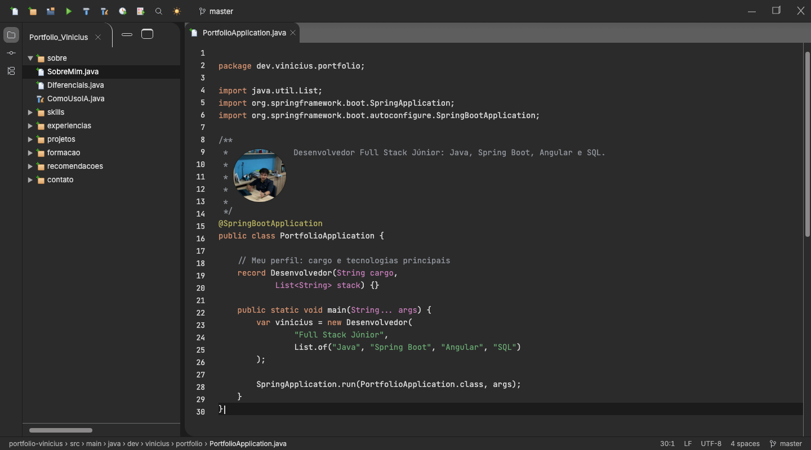
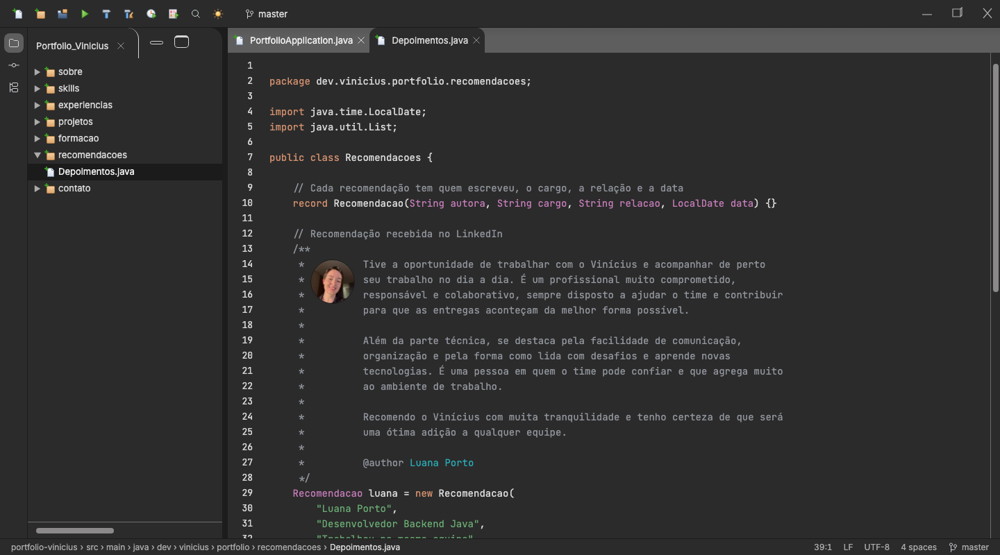
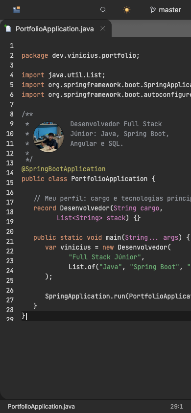

# 0015: Fotos de perfil

- **Data:** 2026-10-14
- **Change:** [fotos-de-perfil](../../openspec/changes/archive/2026-10-14-fotos-de-perfil/)
- **PR:** [#31](https://github.com/viniassuncao1/Portifolio-Vinicius-Machado/pull/31)
- **ADRs:** nenhum novo. A change segue o [ADR-0012](../adr/0012-design-original-com-elementos-do-intellij.md).

## Problema

O portfólio ainda não tinha rosto: quem visitava não via o Vinicius, e a recomendação da Luana
Porto aparecia só como texto. Uma foto aproxima o visitante, e a de quem recomenda reforça que a
recomendação é real. Só que o design não prevê fotos, e elas precisavam entrar **sem quebrar a
ideia de "código dentro da IDE"**.

## Decisões

- **O retrato mora no Javadoc.** O IntelliJ mostra imagens dentro do comentário de documentação
  renderizado, então a foto entra assim: redonda, à esquerda do texto do Javadoc, sem mudar o
  código exibido. A função nova, `javadocComRetrato`, aceita a foto e, opcionalmente, um `@author`.
- **Três lugares.** O Início e o Sobre Mim com a foto do Vinicius (96 px) e a recomendação com a da
  Luana (64 px), onde o nome dela vira link para o LinkedIn, abrindo em nova aba.
- **Imagens leves e sem deslocar o layout.** WebP com 2x o tamanho exibido, de poucos KB cada,
  `NgOptimizedImage` com largura e altura fixas, `priority` só na foto acima da dobra e `alt`
  descritivo. Borda de 1 px por token, nos dois temas.
- **A foto da Luana foi enviada pelo Vinicius**, com a autorização dela. Nada foi baixado do
  LinkedIn.
- **Fora do escopo:** galeria, fotos em outras seções e foto no cartão de compartilhamento, que
  continua como está.

## Aprendizado

- **Dá para pôr imagem numa interface de código sem quebrar a metáfora.** Em vez de um bloco de
  foto solto, ela vai onde o IntelliJ a colocaria: no Javadoc renderizado.
- **Privacidade começa na origem da imagem.** A foto de outra pessoa só entra se ela mesma (ou
  quem tem a autorização) a enviou. O processo ficou documentado no guia de como acrescentar uma
  recomendação.
- **Foto é peso e é layout.** Tamanho fixo e WebP de poucos KB evitam deslocamento de layout e
  mantêm a página leve.
- **Números finais.** 781 testes unitários (96,87% de cobertura de instruções) e 766 testes E2E.

## Links

- Change: [`openspec/changes/fotos-de-perfil`](../../openspec/changes/archive/2026-10-14-fotos-de-perfil/)
- Documentação: [componentes](../componentes.md#editordecodigo)
- Entrada anterior: [0014 janela de Run e Java para leitura](0014-janela-de-run-e-java-para-leitura.md)

## Rascunho de post para o LinkedIn

> Meu portfólio finalmente ganhou um rosto. E o desafio era fazer isso sem trair a ideia de uma IDE.
>
> O site mostra tudo como código Java, e o design não previa fotos. A solução veio do próprio
> IntelliJ: ele renderiza imagens dentro do comentário de documentação. Então a minha foto entrou no
> Javadoc da página inicial e do Sobre Mim, redonda, à esquerda do texto. Na recomendação que a
> Luana Porto escreveu para mim, a foto dela aparece no mesmo lugar, com um @author que leva ao
> LinkedIn dela.
>
> Os cuidados: imagens em WebP de poucos KB, com tamanho fixo para a página não pular, borda por
> token nos dois temas e alt descritivo. E a foto da Luana veio dela, com autorização, e não
> baixada de um perfil.
>
> O aprendizado: dá para encaixar um elemento que o design não previa se você procura onde a
> ferramenta de referência o colocaria.
>
> Você já precisou encaixar algo "fora do design" sem quebrar a identidade?
>
> #Angular #Java #IntelliJ
