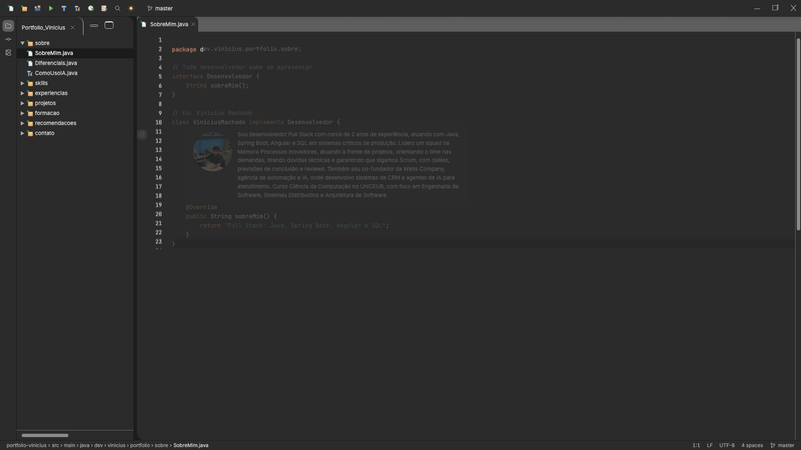
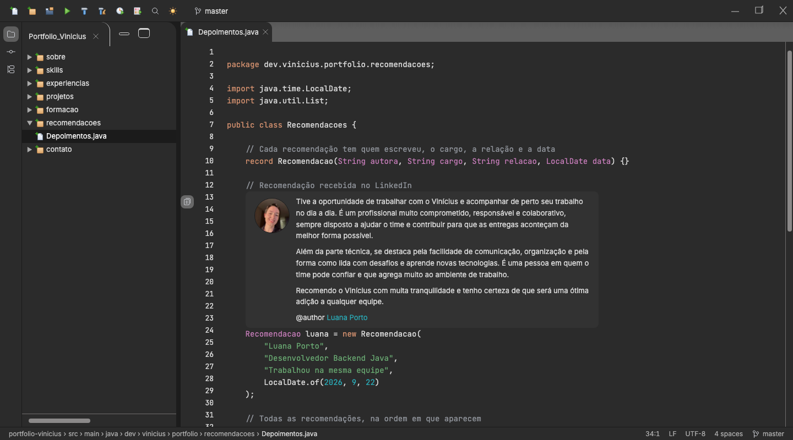
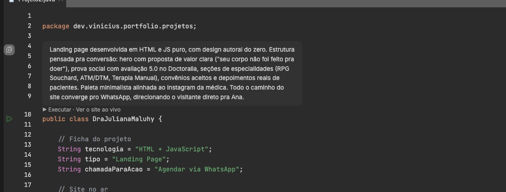
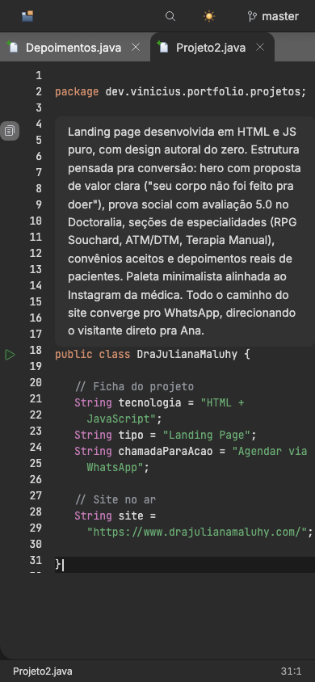

# 0016: Boas-vindas, repositório no estilo do GitHub e melhorias de UX

- **Data:** 2026-10-14
- **Changes:** [tela-de-boas-vindas](../../openspec/changes/archive/2026-10-14-tela-de-boas-vindas/), [repositorio-no-estilo-do-github](../../openspec/changes/archive/2026-10-14-repositorio-no-estilo-do-github/) e [melhorias-de-ux](../../openspec/changes/archive/2026-10-14-melhorias-de-ux/)
- **PR:** [#34](https://github.com/viniassuncao1/Portifolio-Vinicius-Machado/pull/34)
- **ADRs:** [0015](../adr/0015-tela-de-boas-vindas.md) e [0016](../adr/0016-repositorio-no-estilo-do-github.md)

## Problema

Com o site completo, o Vinicius pediu uma **auditoria de UX**, feita com as skills do ECC
`web-design-guidelines`, `make-interfaces-feel-better`, `redesign-existing-projects` e
`accessibility`, com capturas em desktop e celular nos dois temas. A pergunta era simples: um
recrutador com 30 segundos entende quem é o Vinicius, para onde ir e como falar com ele? A resposta
foi não, por três motivos:

- **A abertura era um console.** A janela de Run cobria 37 a 40% da tela e continuava aberta depois
  do log. Não se via o rosto nem o nome de ninguém.
- **O painel do Git era um log cru.** Os 442 commits cobriam o editor, o grafo virava uma faixa só,
  os detalhes começavam vazios e a lista era dominada por "docs: marca a tarefa…". Ninguém entendia
  para que servia.
- **Faltavam caminhos.** Contatos que não pareciam links (e o axe acusando `target-size` no
  celular), nenhuma indicação de onde seguir lendo, o preview dos projetos difícil de achar e o
  código cortado à direita no celular.

## Decisões

Três changes, um PR.

**Tela de boas-vindas** ([ADR-0015](../adr/0015-tela-de-boas-vindas.md)):

- Uma splash no estilo do IntelliJ, com foto, nome, cargo, "Seja bem-vindo" e uma barra que
  percorre as etapas do log do Spring. Dura de 0,6 a 2 s, sem pular, uma vez por sessão.
- Ela é só uma camada do navegador: o HTML pré-renderizado fica inteiro no DOM. A janela de Run
  deixou de abrir sozinha e continua no Executar.

**Repositório no estilo do GitHub** ([ADR-0016](../adr/0016-repositorio-no-estilo-do-github.md)):

- O painel do Git virou uma página do repositório numa aba do editor (`/repositorio`), com uma frase
  explicando o que ela mostra, os números, a proporção de commits por tipo, os últimos pull requests
  (com o título de cada um, agora gravado no build) e os últimos commits de código, mais um link para
  o histórico completo no GitHub. O histórico continua gerado no build, sem token e sem e-mails.

**Melhorias de UX:**

- **Início que se apresenta**, com `@author`, `h1` e atalhos `// Próximo: ver os projetos →` e
  `// Fale comigo →`, e **"Próximo arquivo →"** no fim de cada seção.
- **Modo de leitura do Javadoc**, a Rendered View do IntelliJ: bio e depoimentos aparecem como texto
  formatado, com um botão de livro na calha para ver o comentário cru.
- **Code vision** acima da classe dos projetos com site: `▶ Executar · Ver o site ao vivo`.
- **Celular:** quebra suave do código, botão "Seções" com rótulo e pastas abertas na gaveta.
- **Contatos** com sublinhado pontilhado, ↗ nos externos, alvo de toque de 24 px (44 px no celular) e
  um botão "Copiar e-mail".
- **Abas:** no máximo 5, como o "Tab limit" do IntelliJ, e ícones decorativos mais apagados.

## Aprendizado

- **Auditar com ferramentas e olhar de visitante.** Rodar as skills de UX, de acessibilidade e de
  design em desktop e celular, nos dois temas, achou o que a revisão de código não via: o console
  que cobria a tela, o log do Git que ninguém entendia e o alvo de toque pequeno.
- **A simulação de IDE não pode custar a leitura.** Cada elemento de "IDE de verdade" (Run, Git,
  abas) precisava sobreviver a uma pergunta: ajuda quem está avaliando? A abertura automática e o log
  cru não passaram; o que ficou ganhou um propósito claro (o repositório explica o processo).
- **Imitar também o que ajuda.** O IntelliJ tem a Rendered View, o code vision e o limite de abas, e
  os três resolviam problemas reais de UX. Seguir a ferramenta de referência deu soluções prontas.
- **Splash curta, e nunca no lugar do conteúdo.** Um teto de 2 s, o HTML sempre no DOM e uma vez por
  sessão mantêm a primeira impressão pessoal sem custar SEO nem paciência.
- **Três changes num PR exigiram donos de arquivo.** Com seis agentes na mesma branch, cada um só
  editou os arquivos da sua faixa e o `git add` foi sempre com o caminho exato.
- **Números finais.** 820 testes unitários (97,42% de cobertura de instruções) e 847 testes E2E.

## Links

- Changes: [`tela-de-boas-vindas`](../../openspec/changes/archive/2026-10-14-tela-de-boas-vindas/),
  [`repositorio-no-estilo-do-github`](../../openspec/changes/archive/2026-10-14-repositorio-no-estilo-do-github/) e
  [`melhorias-de-ux`](../../openspec/changes/archive/2026-10-14-melhorias-de-ux/)
- ADRs: [0015 tela de boas-vindas](../adr/0015-tela-de-boas-vindas.md) e
  [0016 repositório no estilo do GitHub](../adr/0016-repositorio-no-estilo-do-github.md)
- Documentação: [componentes](../componentes.md) e [arquitetura](../arquitetura.md)
- Entrada anterior: [0015 fotos de perfil](0015-fotos-de-perfil.md)

## Rascunho de post para o LinkedIn

> Um recrutador com 30 segundos consegue entender quem eu sou no meu portfólio? Fiz uma auditoria
> de UX para descobrir, e a resposta foi não.
>
> Usei skills de IA para auditar design, acessibilidade e UX, em desktop e celular, nos dois temas.
> O que apareceu: a abertura era um console que cobria 40% da tela, o painel do Git era um log cru
> de 442 commits que ninguém entendia, e faltavam caminhos para seguir lendo.
>
> Corrigi três coisas. Uma tela de boas-vindas no estilo do IntelliJ, com a minha foto, de no
> máximo 2 segundos e só uma vez por sessão, sem esconder o conteúdo. O painel do Git virou uma
> página do repositório no estilo do GitHub, que explica o processo em 10 segundos. E uma rodada de
> UX: Javadoc em modo de leitura, "Próximo arquivo", contatos fáceis de tocar e o código que quebra
> no celular em vez de cortar.
>
> O aprendizado: cada elemento de "IDE de verdade" precisa justificar que ajuda quem avalia, e a
> própria IDE de referência já tinha várias das soluções.
>
> Você já auditou o seu portfólio com os olhos de quem tem 30 segundos?
>
> #UX #Angular #Acessibilidade
