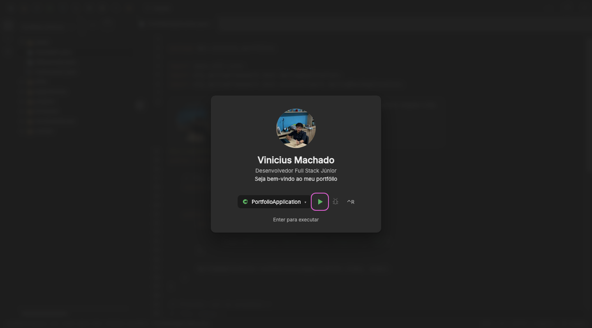
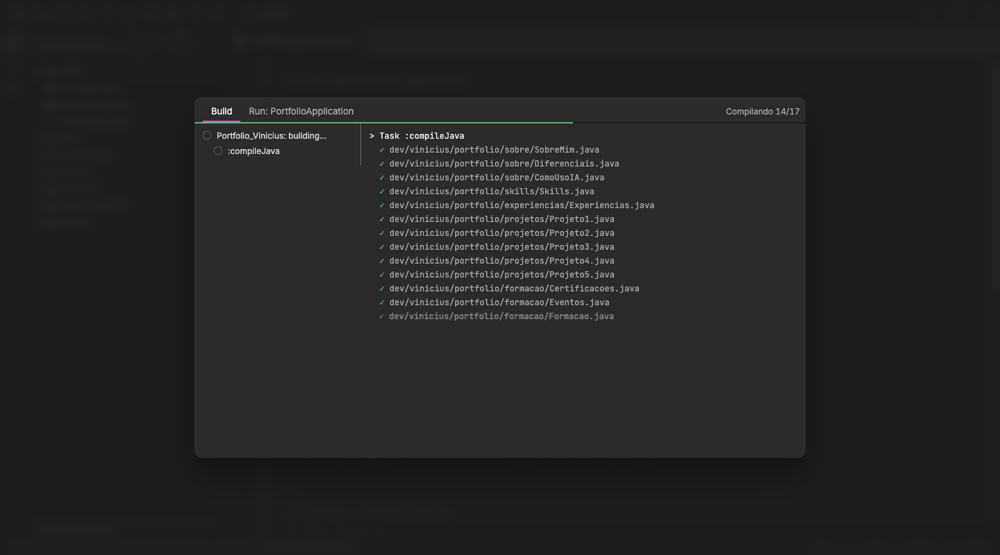

# 0017: Abertura com Run

- **Data:** 2026-10-15
- **Change:** [abertura-com-run](../../openspec/changes/archive/2026-10-15-abertura-com-run/)
- **PR:** [#35](https://github.com/viniassuncao1/Portifolio-Vinicius-Machado/pull/35)
- **ADRs:** [0017](../adr/0017-abertura-com-run.md), que substitui o [0015](../adr/0015-tela-de-boas-vindas.md)

## Problema

A tela de boas-vindas do [diário 0016](0016-boas-vindas-repositorio-e-ux.md) resolveu a primeira
impressão, mas o Vinicius achou que ela era curta demais, de 0,6 a 2 s, e que desperdiçava uma
chance: o site é uma IDE, então a abertura podia ser **rodar o projeto**. O visitante clica em Run e
vê o build e o Spring subindo antes de o portfólio aparecer. Compilar as classes do próprio currículo
e subir um Spring na porta 8080 mostra, logo na entrada, que ele conhece o ecossistema Java.

## Decisões

O plano de design e de animação foi feito antes do código, com as skills do ECC `motion-foundations`,
`motion-patterns`, `motion-advanced`, `frontend-design-direction`, `make-interfaces-feel-better` e
`accessibility`, partindo da auditoria de UX de 14/10, e validado num protótipo de HTML. O storyboard
quadro a quadro está na change.

- **Uma sequência em fases.** Splash de 3 s (foto, nome, cargo e as etapas da IDE), widget de Run com
  o ▶ pronto, build das classes reais do portfólio (uma por seção) (`> Task :compileJava`…), log do Spring até
  `Started PortfolioApplication` e, por fim, a IDE aparecendo: a janela recolhe para a barra de
  status e os painéis entram em sequência.
- **Sem pular.** Foi uma decisão do Vinicius: nem botão nem Esc. O cuidado foi dar um teto a cada
  fase e acionar o ▶ sozinho 5 s depois de pronto, para ninguém ficar preso.
- **Só na página inicial e uma vez por sessão.** Quem chega por link direto de uma seção vai ao
  conteúdo, só com o aviso na barra de status.
- **Movimento reduzido tem versão estática:** as mesmas etapas, sem animação.
- **O conteúdo continua no HTML.** O cartão é pintado no primeiro quadro por um script inline, como
  o do tema, e o conteúdo da rota fica no DOM por baixo.
- **O log do Spring é compartilhado** entre a abertura e a janela de Run, num único módulo.
- **Descartei** manter a tela curta, o botão Pular e a abertura em toda visita.

## Aprendizado

- **Planejar a animação antes de codar.** Um storyboard com tempos, easings e tetos, mais um
  protótipo aprovado, deixou a implementação dividida entre quatro agentes sem discutir tempo.
- **Sem pular exige disciplina de tempo.** Quando a pessoa não pode sair, o site precisa garantir
  que a espera é curta, tem fim e nunca depende de uma ação: daí os tetos e a execução automática.
- **Acessibilidade é parte da coreografia.** A abertura é um diálogo modal com o resto `inert`, o foco
  vai ao ▶ e depois ao editor, e uma região `aria-live` anuncia só os marcos, não o log linha a linha.
- **O atalho certo depende do sistema.** ⌃R recarregaria a página fora do Mac, então ele usa ⇧F10, o
  atalho do IntelliJ nesses sistemas.
- **Números finais.** 784 testes unitários (95,45% de cobertura de instruções) e 851 testes E2E.

## Links

- Change: [`openspec/changes/abertura-com-run`](../../openspec/changes/archive/2026-10-15-abertura-com-run/)
- ADR: [0017 abertura com Run](../adr/0017-abertura-com-run.md)
- Documentação: [arquitetura](../arquitetura.md#abertura-com-run) e [componentes](../componentes.md)
- Entrada anterior: [0016 boas-vindas, repositório e UX](0016-boas-vindas-repositorio-e-ux.md)

## Rascunho de post para o LinkedIn

> Abrir o meu portfólio agora é rodar um projeto Java de verdade.
>
> O site simula o IntelliJ, e a abertura era uma tela de boas-vindas de 2 segundos. Achei curta e
> sem história. Troquei por uma sequência: uma splash com a minha foto, o botão de Run do IntelliJ
> pronto para ser acionado, o build compilando as classes do próprio portfólio, o Spring subindo
> na porta 8080 e, por fim, a IDE aparecendo.
>
> Antes de codar, planejei tudo quadro a quadro, com tempos e easings, usando skills de IA para
> animação e acessibilidade, e validei num protótipo. A decisão mais difícil foi não deixar pular. A
> compensação é disciplina de tempo: cada fase tem um teto, o botão de Run se aciona sozinho em 5
> segundos, só aparece na página inicial e uma vez por sessão, e o conteúdo continua no HTML.
>
> O aprendizado: quando você tira o botão de sair, a obrigação de não prender o visitante é toda sua.
>
> Você deixaria o visitante pular a abertura do seu site?
>
> #Angular #Java #UX
