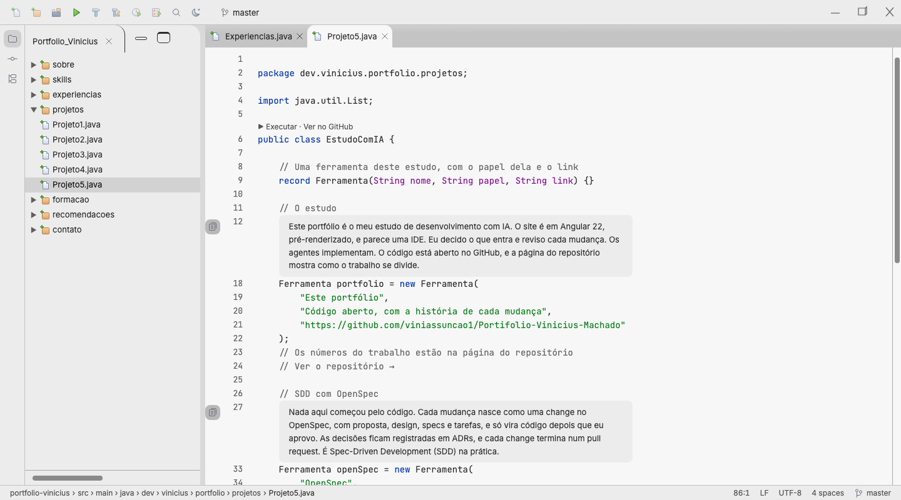

# 0018: Projeto 5, o próprio portfólio

- **Data:** 2026-10-15
- **Change:** [projeto-5-o-proprio-portfolio](../../openspec/changes/archive/2026-10-15-projeto-5-o-proprio-portfolio/)
- **PR:** [#35](https://github.com/viniassuncao1/Portifolio-Vinicius-Machado/pull/35)
- **ADRs:** nenhum novo.

## Problema

O próprio portfólio é o projeto que mais mostra como o Vinicius trabalha hoje: um estudo de
desenvolvimento com auxílio de IA, com specs antes do código, regras e skills de mercado e uma
equipe de agentes orquestrada. Só que isso aparecia de passagem, em "Como uso a IA" e na página do
repositório. Faltava um projeto dedicado a contar esse estudo.

## Decisões

- **Um Projeto 5, "Este portfólio"**, em `Projeto5.java`, com **quatro páginas**, como o Projeto 4:
  1. **O estudo:** o portfólio como estudo de desenvolvimento com IA (Angular 22 pré-renderizado, eu
     decido e reviso, os agentes implementam), com links para o repositório e para a página
     `/repositorio`.
  2. **SDD com OpenSpec:** toda mudança nasce como uma change, com proposta, design, specs e
     tarefas, e só vira código depois de aprovada; as decisões ficam em ADRs.
  3. **ECC:** as regras, skills e agentes do Affaan Mustafa, que venceu o hackathon Anthropic x Forum
     Ventures em setembro de 2025, e as skills usadas aqui (auditoria de UX, movimento,
     acessibilidade e escrita).
  4. **Maestri:** o canvas de agentes do desenvolvedor brasileiro Evert Junior e a equipe (Regente,
     Pincel, Compasso, Sentinela, Escriba, Grafite e Nanquim).
- **Fatos de terceiros só com fonte.** O que está sobre o ECC e o Maestri foi verificado em
  15/10/2026 nos próprios repositórios e páginas, com link em cada página. Números que mudam a cada
  commit, como as estrelas do ECC ou o total de commits, ficaram de fora: o do projeto já aparece
  atualizado na página do repositório.
- **Textos na minha voz, sem cara de texto gerado.** Primeira pessoa, frases diretas, no máximo cerca
  de 90 palavras por página, e todos passaram pela skill `li-human` do ECC.
- **Code vision com link externo.** Como o site é este próprio portfólio, não há preview. A linha
  acima da classe virou `▶ Executar · Ver no GitHub` e abre o repositório em nova aba.
- **Entra na abertura sozinho.** A lista de classes que o build da abertura "compila" é derivada de
  `secoes.ts`, então com o Projeto 5 são 17 classes, sem mudar nada na abertura.

## Aprendizado

- **O projeto que melhor mostra o processo é o próprio site.** Em vez de só dizer que trabalho com
  specs e agentes, a seção aponta para o repositório, onde dá para conferir.
- **Verificar antes de citar.** Afirmar algo sobre o trabalho dos outros pede fonte; o que não tinha
  fonte, ou mudava toda hora, não entrou.
- **Derivar listas da fonte única.** A lista de classes da abertura vir de `secoes.ts` evitou um
  número fixo que quebraria na primeira seção nova.
- **Números finais.** 784 testes unitários (95,45% de cobertura de instruções) e 851 testes E2E.

## Links

- Change: [`openspec/changes/projeto-5-o-proprio-portfolio`](../../openspec/changes/archive/2026-10-15-projeto-5-o-proprio-portfolio/)
- Documentação: [componentes](../componentes.md)
- Entrada anterior: [0017 abertura com Run](0017-abertura-com-run.md)

## Rascunho de post para o LinkedIn

> O melhor projeto do meu portfólio é o próprio portfólio.
>
> Ele foi um estudo de desenvolvimento com IA, e agora tem uma seção só para contar isso, em quatro
> páginas: o processo, as specs antes do código com o OpenSpec, o ECC (regras, skills e agentes do
> Affaan Mustafa, que venceu o hackathon Anthropic x Forum Ventures em 2025) e o Maestri, um canvas
> de agentes de código criado pelo brasileiro Evert Junior, onde a minha equipe de sete agentes
> trabalha. Eu decido o que entra e reviso cada mudança. Os agentes implementam.
>
> Dois cuidados. Cada afirmação sobre o trabalho dos outros foi conferida na fonte e vem com link.
> E nenhum número que muda a cada commit foi escrito no texto: ele aparece atualizado na página do
> repositório, que está a um clique.
>
> O aprendizado: em vez de dizer que trabalho com specs e agentes, deixei o código e a história de
> cada mudança abertos para quem quiser conferir.
>
> Você mostra o processo do seu projeto, ou só o resultado?
>
> #IA #Angular #OpenSpec
