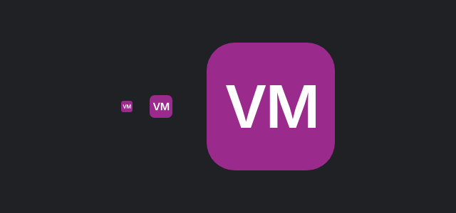

# 0021: Ícone com as iniciais

- **Data:** 2026-10-16
- **Change:** [icone-com-iniciais](../../openspec/changes/archive/2026-10-16-icone-com-iniciais/)
- **PR:** [#39](https://github.com/viniassuncao1/Portifolio-Vinicius-Machado/pull/39)
- **Testes:** 786 testes unitários e 876 testes E2E (24 novos para o ícone)
- **ADRs:** nenhum novo.

## Problema

A aba do navegador ainda mostrava o favicon padrão do Angular. O site inteiro imita uma IDE, e o
primeiro pixel que a pessoa vê estava com a identidade de outro projeto.

## Decisões

- **Iniciais num quadrado arredondado.** O IntelliJ New UI identifica cada projeto por um quadrado
  colorido com as iniciais. Usei o mesmo recurso: "VM" em branco sobre o acento `#9A2A8C`, que tem
  contraste melhor com as letras e funciona em abas claras e escuras.
- **Letras em contornos.** A Inter 600 foi convertida em caminhos dentro do SVG, então o ícone não
  depende de fonte instalada.
- **Um SVG, vários arquivos.** `public/favicon.svg` é a fonte. `scripts/gerar-icones.mjs` gera os
  PNG de 16, 32, 48 e 180 px e o `favicon.ico`, para navegadores antigos e para o iOS.
- **Fora do escopo:** manifesto de PWA e ícones por tema do sistema.

## Aprendizado

- **Detalhe pequeno também é identidade.** O ícone aparece em toda aba, favorito e histórico, e é
  barato de acertar.
- **Gerar por script evita ícone desatualizado.** Mudou o SVG, roda o script e os formatos saem
  juntos.

## Links

- Change: [`openspec/changes/icone-com-iniciais`](../../openspec/changes/archive/2026-10-16-icone-com-iniciais/)
- Documentação: [ícone do site](../arquitetura.md#ícone-do-site)
- Entrada anterior: [0020 domínio próprio](0020-dominio-proprio.md)

## Rascunho de post para o LinkedIn

> Meu portfólio parece uma IDE, mas a aba do navegador ainda mostrava o ícone padrão do Angular.
>
> Troquei por um "VM" branco num quadrado arredondado roxo, no estilo do ícone de projeto do
> IntelliJ, que identifica cada projeto pelas iniciais. A cor tem contraste bom com as letras e
> aparece bem em abas claras e escuras. As letras viraram contornos dentro do SVG, então o ícone não
> depende de fonte instalada.
>
> O desenho mora num SVG só. Um script gera os PNG de 16, 32, 48 e 180 px e o favicon.ico, para
> navegadores antigos e para a tela inicial do iOS. Se eu mexer no desenho, um comando atualiza
> tudo.
>
> Fica de fora, por enquanto, o manifesto de PWA e ícones por tema do sistema.
>
> É um detalhe pequeno, mas ele aparece em toda aba, favorito e histórico, e custa pouco para
> acertar.
>
> Que detalhe pequeno do seu projeto você ainda não acertou?
>
> #Angular #UX #Frontend
