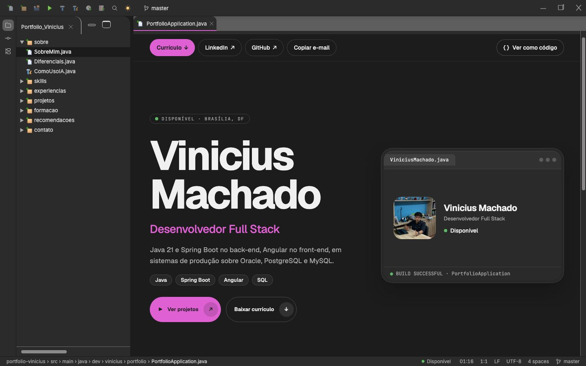
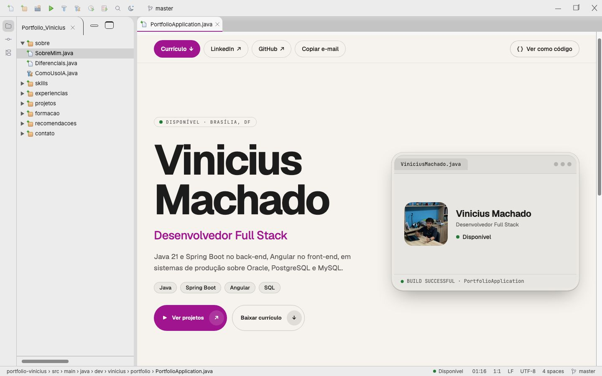
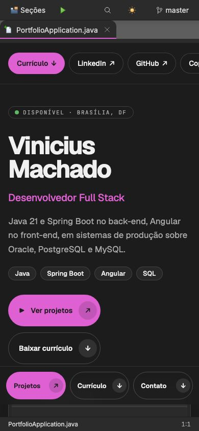
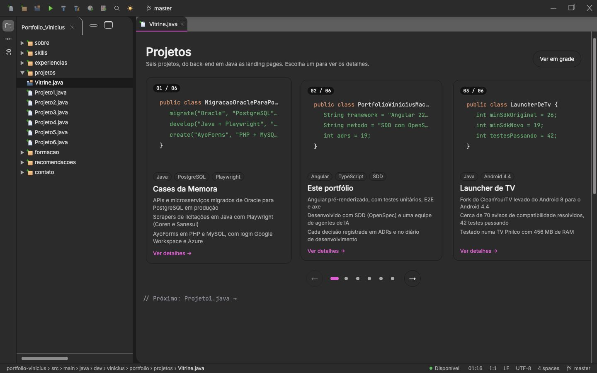
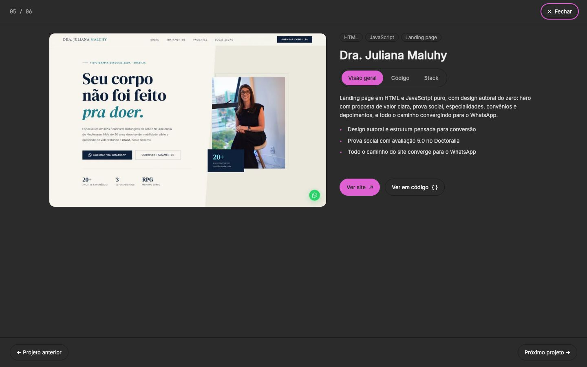

# 0023: Experiência focada em recrutadores

- **Data:** 2026-10-20
- **Change:** [refatorar-experiencia-do-usuario](../../openspec/changes/refatorar-experiencia-do-usuario/)
- **PR:** a abrir
- **ADRs:** [0019](../adr/0019-experiencia-focada-em-recrutadores.md)

## Problema

A casca de IDE funciona, mas a experiência é estática e presa ao design original: seções como
arquivos de código, projetos sem vitrine, pouco movimento e uma árvore que o recrutador precisa
entender antes de achar o que importa. O pedido é uma experiência mais viva e mais clara para quem
recruta, com a IDE como referência mínima.

## Linha de base (antes da change)

Medida em 2026-10-20/21 sobre o build de produção, com Lighthouse 12 no perfil móvel padrão
(throttling simulado) e o axe dos E2E. **A primeira medição usou um servidor local sem compressão
e deu desempenho de 70 a 74 e LCP de 4,5 a 5,1 s: era um artefato.** A Vercel entrega HTML, JS e CSS
comprimidos; depois de pôr brotli e gzip em `e2e/servidor.mjs`, o mesmo build da `main` (commit
`9d8a4cf`) deu o resultado abaixo, que é o que vale como linha de base.

| Página       | Desempenho | LCP   | CLS   | TBT  |
| ------------ | ---------- | ----- | ----- | ---- |
| `/`          | 100        | 1,1 s | 0,02  | 0 ms |
| `/skills`    | 100        | 0,9 s | 0,014 | 0 ms |
| `/projeto-2` | 100        | 0,9 s | 0,036 | 0 ms |

- **axe (WCAG 2 A e AA):** 0 violações nas 37 verificações dos E2E, no celular; acessibilidade,
  boas práticas e SEO em 100 no Lighthouse.
- **Leitura:** o site já estava no teto em tudo. A meta da change deixa de ser "corrigir o LCP" e
  passa a ser **não piorar**: desempenho 100, LCP até 2,5 s e CLS até 0,05 com a página nova.

## Depois da visão geral

`/` em cartão (hero, provas, sobre, stack, experiência, formação, projetos e contato, com tema por
seção): desempenho 100, acessibilidade 100, boas práticas 100, SEO 100, **LCP 1,1 s, CLS 0,009,
TBT 40 ms**. O CLS começou em 0,045: a barra de ações mudava de linha quando o botão "Copiar
e-mail" aparecia depois da hidratação; hoje o botão ocupa o lugar desde o HTML pré-renderizado.

## Medições da biblioteca de movimento

Empacotadas com o esbuild (minificadas, gzip): `animate` + `inView` do `motion` somam 24,6 KB e
`motion/mini` (só `animate`) 3,3 KB. A biblioteca é carregada por `import()` e só quando há
movimento. A conferência de que o pacote inicial não a contém só faz sentido quando o primeiro
componente usar as diretivas (grupo 5).

## O que já foi entregue

- Temas de cor por seção com teste de contraste, camada de movimento com `motion` (diretivas
  `appRevelar`, `appMagnetico` e `appContador`) e a vitrine de projetos em `/projetos`.
- A expansão do cartão até a tela cheia só funcionou de verdade depois de entender que o roteador
  abria a própria View Transition logo depois da minha e interrompia a animação. A solução foi
  deixar o roteador conduzir: a vitrine só combina qual cartão é a origem (`TransicaoDoProjeto`).
- O E2E da vitrine achou três bugs reais que os testes unitários não pegaram: o `offsetParent` dos
  cartões estava errado (a centralização do carrossel falhava), os cartões tinham larguras
  diferentes por causa do `min-width` de itens flex e o foco inicial do diálogo ia para o lugar
  errado.

## Telas

Geradas por `node scripts/capturar-telas.mjs` (nos dois temas, com movimento reduzido):

| Início 1440 (escuro)                                                   | Início 1440 (claro)                                                  |
| ---------------------------------------------------------------------- | -------------------------------------------------------------------- |
|  |  |

| Início 390                                               | Vitrine de projetos                                          | Detalhes de um projeto                                          |
| -------------------------------------------------------- | ------------------------------------------------------------ | --------------------------------------------------------------- |
|  |  |  |

## Decisões

- ADR-0019: a IDE vira linguagem, cartão e código são duas visões, vitrine de projetos, `motion` no
  lugar do GSAP e abertura que pode ser pulada.

## Aprendizado

- **Medir antes e conferir a medição.** O LCP de 4,5 s era um servidor local sem compressão; o
  problema real nunca foi desempenho, e a meta virou "não piorar".
- **O E2E acha o que o teste unitário não acha:** a expansão do cartão perdia a animação porque o
  roteador abria a própria View Transition logo depois da minha, e só um teste que amostra as
  animações do pseudo-elemento mostrou isso.
- **Layout que muda na hidratação conta como CLS:** o botão "Copiar e-mail" que só aparecia depois
  da hidratação mudava a barra de ações de linha (CLS de 0,045 para 0,009 reservando o lugar).
- **Duas visões do mesmo conteúdo exigem um teste que as compare:** `perfil.spec.ts` lê as seções
  em código e falha se o cartão divergir delas.
- **Biblioteca carregada depois de um `await` precisa saber se a vista ainda existe:** registrar
  `onDestroy` depois do `import()` quebrava ao navegar rápido (NG0911).

## Links

- Entrada anterior: [0022 textos para vagas Java](0022-copy-para-vagas-java.md)
