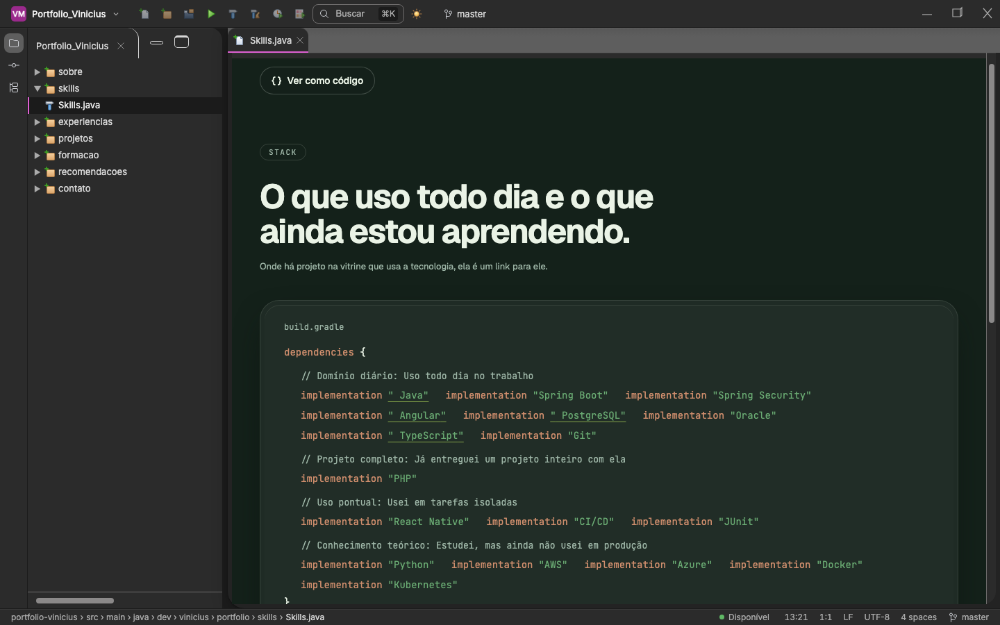
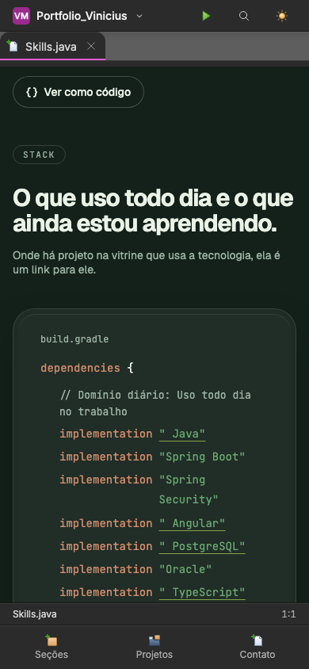

# 0025: Fechando a experiência

- **Data:** 2026-10-21
- **Change:** [refatorar-experiencia-do-usuario](../../openspec/changes/refatorar-experiencia-do-usuario/) (grupo 9, fechamento)
- **PR:** a definir (sem publicar)
- **Testes:** a definir
- **ADRs:** [0019](../adr/0019-experiencia-focada-em-recrutadores.md) e o ADR-0020 (deploy de produção manual, na branch `ci/deploy-manual-de-producao`)

## Problema

O segundo PR da change marcou a tarefa de redesenhar a casca como feita com só um acabamento de CSS
([entrada 0024](0024-refinos-da-experiencia.md)). O redesenho pedido pelo design (seção "Casca
reimaginada") ainda não existia. O Vinicius pediu para terminar tudo de uma vez, dividido na
equipe, e revisar no `localhost:4200`.

## Decisões

- **A produção fica com a versão anterior, de propósito.** O deploy de produção passou a rodar só
  pelo botão "Run workflow" (ADR-0020). Um merge na `main` testa, mas não publica. Assim o Vinicius
  revisa a experiência nova no `localhost:4200` e decide quando ela vai ao ar.
- **Casca nova pelos tokens v2.** Superfícies double-bezel: o editor numa bandeja com raios
  concêntricos, fio de luz no topo e sombra em duas camadas, nos dois temas. As proporções e a
  paleta saem dos tokens, não das telas do design.
- **Barra superior com identidade.** Widget do projeto com o selo **VM** (o rosa do favicon, com
  contraste de 5,2:1), Executar, busca em pílula com o atalho Ctrl/Cmd+K e a branch.
- **Painel do projeto recolhível.** Botão ou Ctrl/Cmd+B, com a escolha lembrada na sessão. O estado
  só é lido depois da hidratação, então o HTML pré-renderizado sai sempre com o painel aberto e não
  diverge do que o navegador monta.
- **Celular com barra de ações.** Seções, Projetos e Contato ficam embaixo, e a gaveta do painel
  abre pelo botão Seções.
- **Galeria de revisão.** `node scripts/capturar-revisao.mjs` captura todas as rotas em 320, 768,
  1024 e 1440 px, nos dois temas, e escreve `.maestri/capturas/revisao/index.html`.

## Aprendizado

- **Marcar como feito não é o mesmo que estar feito.** A tarefa estava `[x]` com um acabamento de
  CSS; o desenho tinha pedido outra coisa. Reler o `design.md` contra a tarefa achou a lacuna.
- **Separar "mergear" de "publicar" dá liberdade para iterar.** Com o deploy manual, a `main` pode
  receber trabalho sem que o visitante veja algo pela metade.
- **Estado lembrado tem de respeitar o pré-render.** Ler o `sessionStorage` só depois da hidratação
  evita um HTML que mente.

## Links

- Change: [`openspec/changes/refatorar-experiencia-do-usuario`](../../openspec/changes/refatorar-experiencia-do-usuario/)
- Documentação: [componentes](../componentes.md#casca) e [arquitetura](../arquitetura.md#casca-reimaginada-fechamento-da-experiência)
- Entrada anterior: [0024 refinos da experiência](0024-refinos-da-experiencia.md)

## Rascunho de post para o LinkedIn

> Marquei uma tarefa como concluída e ela não estava.
>
> No meu portfólio, o "redesenho da casca" tinha virado um ajuste de CSS. O design pedia outra
> coisa: uma barra superior com o projeto, busca com atalho, painel recolhível e uma barra de ações
> própria para o celular. Reli o design contra a tarefa e a lacuna apareceu.
>
> Refizemos a casca com tokens novos: o editor numa bandeja com cantos concêntricos, fio de luz no
> topo, selo "VM" no widget do projeto, busca em Ctrl/Cmd+K e painel que recolhe com Ctrl/Cmd+B. O
> estado do painel só é lido depois da hidratação, para o HTML pré-renderizado não divergir do que
> o navegador monta.
>
> E uma decisão de processo: a produção ficou com a versão anterior de propósito. O deploy agora só
> roda pelo botão "Run workflow", então um merge testa, mas não publica. Eu reviso tudo no
> localhost antes de decidir.
>
> Quando foi a última vez que você conferiu uma tarefa "pronta" contra o que foi pedido?
>
> #Angular #UX #CICD
